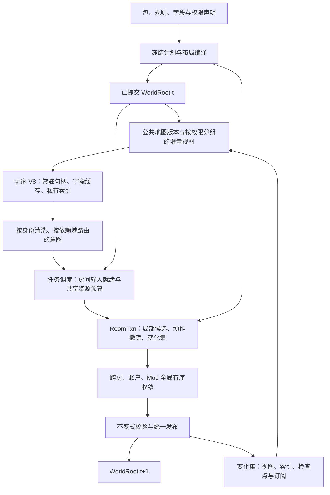

# 高性能、低内存与完整 Mod 扩展的目标架构

方案日期：2026-10-11。属性：**完整目标设计，尚未全部实现**。具体设计取舍见 [ADR-020](../decisions/ADR-020-incremental-world-runtime.md)，实施与验收见[重构计划](../plans/performance-rearchitecture.md)。现状以[总体架构](overall.md)、[接手台账](../plans/mod-next-batches.md)和源码为准；已有局部共享/视图复用/受限并行不等于下文完整架构已交付。方案提出时依据为 `525ec789` 及[关键路径调研](../research/12-performance-critical-path-review.md)，当时没有新增性能测量。

## 1. 目标与不能混淆的边界

同时实现三项目标：在明确的共同工作负载上持续领先 xxscreeps；稳态和峰值内存更低；JS Mod 覆盖对照版本的贡献领域，作者新增玩法无需修改 Rust 或重新构建宿主。

**验收深度（2026-10-11 用户收敛）**：三目标保留，性能验证锚定 50×6（B0）单一场景——开发与批次用分钟级短窗快速迭代（进程内交替 A/B、多短窗取中枢），小时级长窗只在最终验收出现；扩展场景（热点/规模/混合 Mod/少核/长跑）作为登记场景库按需抽查或随部署里程碑执行，不构成性能线门禁。不为验证等待数小时拖慢开发节奏。

单一成熟房结果不外推为全部场景结论；也不保证任意人为编写、耗时任意长的 JS 在同代 V8 中都有固定倍数收益。在同资源、用户代码成本不变的串行分解中，用户代码占比为 p 时，即使消除其余开销，加速上限也只有 1/p；不能把 CPU 样本占比直接代入并行墙钟公式。优化后必须分列用户代码与宿主开销。

保留当前玩家契约、原子候选发布、失败轮不重复执行玩家代码、Mod 组合/拒绝/故障语义。V8 玩家全局不在事务内这一边界也保留。旧容器、线格式、跨 crate 接口、房间串行实现、固定线程配置均可替换。Node 源码/任意 Node 内部接口兼容仍不在既有业务能力等价目标内；该边界不作为漏掉贡献领域的理由。

## 2. 总体结构

目标是一套**以房间为存储局部性单元、以受控事务记录变化、以不可变版本供读取、以依赖图调度任务**的单进程内核。生产玩家隔离可移入受限进程，但逻辑协议不变化，全部进程成本进入性能账本。



只有 C 能改变已提交世界。完成单房计算、缓存编码或玩家执行都不是发布。下一拍玩家不能读取尚未完成全局收敛的房间。

## 3. 权威状态：紧凑房间存储与稳定身份

### 3.1 存储表示

建议替换 `BTreeMap<ObjId, RoomObject>` 热循环中心，建立 `RoomStore`：

- 房间目录映射到稳定 RoomHandle；对象公共 ID 不变，内部使用含代次的 EntityHandle，删除复用槽不得令旧句柄指向新对象。
- 每房按冻结 TypeHandle 分桶，以分块的紧凑列或混合 AoS/SoA 储存高频字段；少量冷字段与变长值单独存储。选择列宽、块大小及紧凑位置表示都须实测，不冻结拍脑袋页大小。
- ID 到 slot 的定位与确定性遍历分离：查询走索引，游戏顺序走稳定 ID/既定动作序。物理 swap-remove、压实或哈希种子不能改变规则顺序。
- 字符串、body、资源集合使用房内或内容版本内的不可变 arena；资源以动态 ResourceHandle 表示，保留名称导出和自定义资源。小库存用稀疏紧凑表示，密集转换阈值由数据决定。
- arena 回收/压实在受控边界执行，记录未回收字节与峰值；不能让一条长寿命小引用无限钉住历史大页。内部偏移不暴露为永久玩家身份。

这是按负载选择的数据导向实现，不要求采用通用 ECS 框架。结构化列若在随机动作写入中更慢，可以保留小块行存储；必须得到端到端和 RSS 证据，而不是只测顺序扫描。

### 3.2 schema 编译与动态扩展

冻结计划产生 TypeLayout、FieldHandle、资源编号、权限分类、编码访问计划和校验程序。内建 Rust 访问器是同一声明的生成适配器；运行时 JS 自定义类型经通用句柄访问，新增类型无需编译 Rust。

保留 missing/null、数值范围、枚举、数组/对象、动态字段及其可观察键序。未知动态结构走通用值页或不透明载荷，不以“难以列式化”拒绝合法 Mod。Generic JSON 作为导入/导出和过渡表示；热点对象逐步结构化，禁止长期同时保有完整 JSON 树、字符串、typed 对象和编码块四份权威副本。

无需把 JSON/二进制存盘格式强制等同于内存布局。公开视图还受权限裁切，不能直接把权威数据页交给玩家。所谓共享布局是共用 schema 与可复用的合法数据，不是泄露 ServerOnly 字段的借口。

### 3.3 版本

版本分工：WorldEpoch 标识一次完整发布；RoomRevision 标识房内容；TopologyRevision 标识成员/位置/类型；TerrainRevision 和 MapRevision 管地形/公共房态；PlanIdentity 与 ExecutionIdentity 管 schema、有效规则、包和活动处理链；AudienceIdentity 管受众。

缓存键只引用真正依赖的版本，但绝不以局部版本代替完整世界一致性。计数器防回绕；恢复、换包和管理员编辑必须走同一版本发布入口。静态房态含时间语义时，缓存种子不冻结按当前墙钟计算的返回值。

**权威字段没写入不等于玩家视图没变化。** 当前 `kkpv/objects.rs` 用 `age_time - time` 生成 ticksToLive，用 decay_time 生成 ticksToDecay。视图失效须同时覆盖权威 ChangeSet、tick/墙钟、有效规则、观看者关系和本拍事件生命周期。每个派生字段声明这些依赖：时间字段可传绝对截止点、在绑定当前 tick 的可信 getter 计算；保留旧线格式时逐拍刷新对应投影字段。不能等到 R10 定时调度才补这条链，否则 R06 已会缓存过期值。状态不变但 tick 推进、同 tick 改归属/规则、事件清空均为必测反例。

## 4. 候选事务与变化集：唯一写入口

### 4.1 事务结构

`WorldRoot` 引用不可变已提交房页、玩家、市场、Mod state 及其他权威域；`TickTxn` 基于它构造候选。未变页共享；首次写入复制小页或记字段覆盖，密集写入可切为独占紧凑副本。禁止每字段独立 Arc/HashMap 带来更大的元数据成本。

所有引擎规则、JS Mod、管理编辑、跨房转移与恢复写入经受控接口，例如 `read/write/insert/remove/transfer`。底层可提供经验证的批量 native 写入口，但必须完整记录变化；不能残留绕过日志的 `&mut RoomObject`。迁移期间未接入接口的旧路径以适配器捕获前后差异、保守标脏，明确计入成本并最终删除。

动作 `Savepoint` 覆盖首次触达字段、对象增删、索引、事件、队列、账户、namespace state 和 ID 游标中实际可写的域。decline 只撤销本动作，异常丢弃整轮候选，之前成功动作不得被局部撤销误伤。当前尚不开放的写域扩展时必须同步接撤销与保存恢复。

### 4.2 ChangeSet

建议结果形态为：

```text
TickCommitCandidate
  base_epoch / input_identity / execution_identity
  changed_room_pages / account_market_mod_state_candidates
  changes:
    created / deleted / transferred objects
    changed fields（含删除、null、layout 变化）
    topology / ownership / visibility / terrain / map changes
    events / timers / cross_domain_requests
  validation evidence / next_id / replay metadata
```

记录写入不等于最终值变化：撤销、写回原值和创建后删除必须正确归并。初期允许多报、禁止漏报。以完整参考差异检验 `actual_changes ⊆ reported_changes`；省比较前建立写入口覆盖清单。

同一 ChangeSet 服务编码、私有索引、授权视图、校验和将来的网络订阅。变化集是内部派生结果，不自动成为业务事件或持久输入日志，避免重放双重应用。

### 4.3 校验与提交

全量校验仍用于外部导入、冷恢复、schema 迁移和调试对照。正常 tick 可逐步改为“写入口局部校验 + 变化域复核 + 全局摘要/索引不变式”，前提是封闭写入口和跨对象依赖齐全。删除对象还须触发引用收敛，不能只检查被直接写过的对象。

完成房、跨域收敛、玩家写回和全部校验后一次发布新 WorldRoot；无需复杂的无锁算法，先用单协调提交者。失败缓存保留原输入/玩家结果，Mod realm 按当前故障契约恢复，重新计算候选。提交前不启动不可撤销外部副作用。

执行尝试与内容版本分离：候选任务带 `(world_incarnation, base_epoch, attempt, task_id)`，发布只接受仍活跃尝试。恢复或替换世界产生新的 incarnation，旧任务不能凭相同 tick/revision 进入新世界。此身份只控制生命周期，不进入玩法 RNG 或改变业务输出。

## 5. 投影协议：内容版本与本次投递分离

近期 P1 优化纳入目标架构，不作为终点：

- 公共地图/地形按内容版本发布，只在变化或新沙箱加入时更新；不随全局 tick 重编码。
- 玩家视图由可见房、不可见但必须导出的自有对象、玩家账户与授权世界通道组成；以关联索引枚举，去掉玩家×全服房间的空块扫描。
- 房对象拆为可公开共享列、owner 列及不导出的 server 列；按有效权限分组，避免一个 Mod 字段让整房丧失共享资格。动态规则可能使受众组变细，缓存有上限、超限回退，不建立无限玩家组合缓存。
- `ViewEnvelope` 固定 epoch、内容引用、plan/execution/audience 身份。接收者显式确认基线；full、patch、unchanged、remove 四类更新，校验目标版本与精确基线。
- 首见、视野进入、跳拍、失败重试、沙箱重建、计划变更走 full 或重建；视野退出必须清除私有成员和旧权限，不能仅停止发新数据。

`ViewEnvelope` 另含 world incarnation、view session 与 update 序号；基线绑定完整内容/权限身份，不能只用 tick。安装采用“全部预检 → 暂存/可撤销更新 → 原子切换视图上下文 → 确认基线”；后半块无效或安装中断不得留下可继续增量更新的半套 resident 表。资源错误无法撤销时将视图标为无效，下轮先 full 重建，安装完成前不执行玩家。迟到/重复确认不得推进当前 session；候选编码的完成也不是沙箱安装确认。

沙箱基线描述它实际已安装的**已提交世界**视图，不随本轮结算成功与否猜测推进。失败结算不把未提交内容交给玩家；重试同一世界、冷恢复复用 tick、视野退出后重入都按身份握手。视野撤销禁止宿主继续更新旧引用，但不能抹除玩家已经合法复制保存的数据；不承诺追溯撤回历史知识。

传输第一阶段继续完整 KKPV，以字段/页复用省编码；新协议在有证明后替换。共享小页/分段传递与一次紧凑拷贝两条实现比较：大量 ArrayBuffer/External 引用可能比一次复制更贵，不预设零拷贝必胜。

物理共享必须满足 host-owned、生命周期可追踪、玩家无法写入或拿到未授权 backing store；JavaScript `Object.freeze` 不等于字节只读。无法建立这一边界就复制授权快照。泄露可写视图、detach/transfer、原型补丁、旧引用都进入测试。

## 6. 玩家 V8：稳定对象句柄与按字段失效

常驻 wrapper 只保留稳定身份和受控 view context；同一 tick 的读取绑定同一发布版本，跨 tick 按既有玩家契约重绑定。不会让玩家持有旧 wrapper 永久钉住整个历史世界。

定宽热字段可保持急切更新，变长字段按字段版本惰性物化；不要把每个数值读取都改成跨宿主 op，也不要为了“全惰性”把原本廉价属性变成昂贵通用 getter。布局编译生成每类型读取计划，避免每拍重新构造字段签名和访问器。

私有 ID、房成员、类型及空间索引消费 ChangeSet。静态成员保留，移动只改旧/新格，hits/store 改变不更新空间索引。公开 Game 集合和查询返回值的可写性照旧，不把玩家修改过的数组/对象当作权威缓存。

物化字段需要分清宿主不可变值与玩家可修改副本；无法证明没有玩家修改时，不跨拍复用公开可变内容。清理隐藏字段时避免逐拍扫描所有用户自挂属性；用宿主私有元数据维护失效，具体 getter 行为由兼容测试约束。

每个玩家仍有独立 isolate 和全局语义。代码缓存、启动快照等只共享可证明无玩家状态的部分。不能通过共享全局或自动清掉长时间不活跃玩家的 JS 堆降低基准内存；允许的 VM reset 必须按公开生命周期与双方相同口径计入。

线程数不必等于玩家数。当前 ThreadExecutor 每玩家独立线程；目标评估有限执行线程各自持有多个独立 isolate，以减少线程/事件循环固定成本与调度唤醒。isolate 从创建到销毁固定在所属线程，线程内轮流完整执行任务，不跨线程移动 deno_core 运行时，也不合并玩家全局。CPU 计费按每个任务差量，watchdog 和回执绑定 player/isolate/attempt/epoch，迟到终止请求不能杀到下一玩家；PathFinder/TLS、微任务、近堆恢复与销毁都需要新的隔离回归。

这个变体须单独比较线程栈**实际驻留**、V8 固定足迹及长尾，不能用虚拟栈预留量宣称 RSS 节省。固定归属可能产生负载偏斜，先用预测成本分配初始归属；不能为再平衡暗中重建玩家全局。若该变体收益不成立，保留每玩家线程但统一执行令牌。公共 prelude 的编译/启动缓存、模块源码 Arc 共享单独评估，玩家代码对象和可变堆仍隔离。

多 isolate 共线程的派发必须受 owner-thread 空闲状态约束，不能将该线程所有玩家一次入队并从入队即消耗现行命令期限，导致后排玩家未运行先超时。ready 排队、执行看门狗与通信期限分别记账，正式执行额度不含排队；任何改变现有 deadline 语义的接口必须独立记录。当前 `kk-vm::Watchdog` 自身也创建线程，减少 PlayerThreads 不会自动减少这些线程；共享 watchdog 是另一独立实验，保留 disarm 后旧代不再投递和销毁前排空的保证。CPU 区间不得混入同线程其他 isolate 的任务/微任务，永久卡住的 native 会扩大故障影响面；未证明可接受前本变体保持关闭，不成为主线前置。

## 7. 调度：房间就绪执行与全域有序收敛

### 7.1 依赖与任务

tick 起点冻结读取版本、输入参与者和可推导依赖。玩家结果完成后先清洗身份/动作，再路由到房间、玩家或世界域。无指令、玩家异常、预算跳过同样产生完成标记，避免房间永等。

不能仅用房主/可见玩家构造等待数：自有对象、远程动作、攻击者、NPC、跨房及 Mod 世界写能力都要覆盖。无法提前确定写目标的处理器进入有序阶段；既有世界级效果保持原先阶段顺序，不任意提升到房间前执行。

就绪房生成候选；跨房移动、市场、账户和世界规则按阶段依赖收敛。所有玩家读 W(t)，候选即使早完成也不能被其他玩家读取。房任务内部保持既定动作顺序；任务完成顺序不得影响提交序。

房任务可执行须同时满足 **input_ready 与 semantic_ready**。后一条件包括串行参考中此前可能影响本任务的账户/ID/namespace/RNG 操作已经完成，或已证明可交换；不是先乱序算、最后排序提交就等价。例如 A 房升级增加 GCL 后 B 房检查占领配额，不能让 B 提前读取旧 GCL，再指望末尾求和修复。新增对象若被后续房内动作/tick/Mod 读取，也不能把创建整体移动到末尾全局阶段；保留原位置的串行依赖，必要时整个房组等待。

自由目标指令可能让 input_ready 退化为等待所有玩家：当前 `Flag.setPosition` 可向未可见房发 createFlag。R00 必须列出每类 API 的目标上界，R09 trace 按这些真实上界计算收益；不能按本次实际“没发旗指令”提前放行，也不能为了重叠禁止已有 API。只有证明某阶段不依赖该动作、保持串行效果顺序时才拆阶段提前计算。没有可用窗口时保留全局屏障，优先减工作量。

### 7.2 早结算的时间输入与失败状态机

当前 `execute_players` 全部返回后才采 `TickInput::now()`；这与提前开始完整房间规则有直接冲突。R09 首片保留采样边界：只有证明不依赖 now_ms 的准备/规则段能提前，墙钟相关段及其依赖仍等原边界。若改为 tick 起点采样，须作为独立时间输入协议变更，更新 host protocol/恢复与黄金断言并验证订单、签名及墙钟寿命；不能把它当作无语义改动的调度细节。

一轮生命周期为 `Running → Quiescing → Prepared/RecoveryRequired → Committed/Aborted`。玩家与候选并行期间任一基础设施故障：停止新派发，撤销本尝试的发布资格，取消未开工任务；已运行任务只写私有候选，结果按 attempt 拒收，所有可能访问候选/realm 的任务结束或完成安全隔离后才能销毁资源。永久阻塞 native 不能假称被 cancellation token 终止，仍按基础设施停顿/进程恢复边界处理。

只要本轮提前执行过 Mod，即使最后失败来自玩家线程/写回构造，也要按原包重建受影响 Mod realm，不能仅在旧 `settle_world_with_writebacks` 报错处恢复。已执行玩家全局仍不回滚。结果齐全的结算失败可缓存完整输入重试；玩家结果未知的基础设施故障只保留已确认结果并停顿，禁止补发、禁止当空指令提交。RNG/预算 begin_settlement 每尝试只初始化一次，不能每个房任务重复清零。

### 7.3 共享状态是硬问题

先将 `TickState` 的 players/ID/namespace state 分出明确能力：快照只读、经证明可交换增量、有序读改写。只有第一、二类可局部化，账户限额、抢占与读后写不能简单求和。未知依赖可将相关房/玩家连成有序组，最坏退化为当前串行能力。

对象 ID 初期继续原语义有序分配；涉及创建且可能观察 ID 的动作进入有序阶段或依赖链。临时 ID 在规则读前无法安全隐藏时禁用。未来更换 ID 协议须独立版本与迁移，不在并行改造中悄悄改变。RNG 同样保持现有流与消费序；只有本来就域分离的调用才能并行，不能借重构重掷随机结果。

### 7.4 资源预算

玩家 VM 执行、规则计算、投影编码和后台工作纳入统一的可配置 CPU 预算。VM 固定线程所有权不变，调度器发令牌/任务而非跨线程搬 V8；房任务保持局部性，空闲计算预算可给准备/编码使用。

队列、跨拍预编码和快照保留均有界；过期任务取消或丢弃，不累积无限 mpsc 队列。基线未到或编码 miss 可内联，但报告重复工作。默认策略按部署核数/限额配置，并通过实测调优，不依赖 macOS P/E 核猜测。

现有 L1a 仅是过渡：变化集省掉编码后可能不再需要两个专职线程；启用新调度前比较保留/合并/关闭三种形式。run/settle/encode 重叠收益不可加总，规则变快也会压缩编码窗口。

## 8. Mod 执行：开放能力与优化资格分离

### 8.1 必须覆盖的领域

沿用完整玩法计划，冻结对照 xxscreeps 的 config、constants、schema、processor、game、driver、main、terrain、storage、backend、test 十一个贡献领域，并将 CLI/类型生成/客户端集成计入作者闭环。先复核固定版本，未来升级版本做差异审计，不暗中移动目标。

每项都有“声明 → 实际消费者 → 组合/替换 → 保存与恢复 → 独立包证明”，不能把有接口名字当成功能等价。processor 还须逐族覆盖采集/再生、spawn/寿命、移动/战斗、建筑/生产、终端/市场、power、跨房/世界生命周期。官方 JS 包须真实实现玩法，第二个同类第三方包不靠新 Rust 分支。

### 8.2 两种执行资格

**通用有序模式**承载所有现有合法能力：共享可信 realm、闭包/模块全局、共享 namespace state、before/wrap/replace/after、next 和 decline 均保留。不可分析的 JS 不强行并行，也不禁止跨域玩法。

**受约束局部模式**是待独立证明的可选研究项：处理器的跨调用持久状态通过显式 room/player/namespace state，读写域由实际 capability 约束，调度使用保守依赖。声明本身不是证明；不能只写 `parallelSafe: true`。无法保证 realm 副本等价的模块继续有序，共享可变模块全局不得静默复制。

host capability 只能约束宿主状态访问，不能阻止 `let counter`、闭包或 JS 原型写入；“只用 ctx.state”不能由声明或冻结导出对象自动证明。**首版 R09 全部 JS handler 保持同一有序 realm，只有已证实独立的 native/准备工作并行。** 后续局部 JS 需先选定可执行隔离机制，例如明确的新会话/模块状态作用域及确定性分区语义，证明不受 worker 数/完成序影响并测算额外 realm 内存；否则保持未开放，不能让整套重构依赖尚无实现机制的纯函数假设。需要新契约的包显式选择，旧包语义不变。

尝试越域时不在副作用发生后偷偷重跑 JS：并行模式只能使用预先授予的作用域，越界按该模式的公开契约失败；需要合法动态跨域能力的包选择通用模式。新模式不能收窄旧模式 API。若将来支持提前升级作用域，必须在 handler 执行前完成，不能以推测回滚掩盖 JS 全局副作用。

### 8.3 降低 JS/宿主往返

冻结计划预编译链分派、字段编号和校验访问；整槽进入 JS 的现有原则保留。增加通用批量读取、事务内写集和领域操作，保持读到自己写入、native next 后刷新、异常/拒绝的可见顺序。批处理不得把 `A.before→A.center→A.after→B...` 改成全部 before 再全部 center。

在不改变调用观察面的情况下可将一房的一段链留在 realm 内解释计划，减少每对象来回；native 步骤通过受控 op 工作。这需要真实混合链基准，不能假设批量必然更快。原生能力对所有包按同一契约开放，不给官方包特殊业务捷径。

默认 preset 的实际 JS/native 组成写入报告。只有 native center 且没有 JS 扩展才叫 Native 直调；正式默认预设含 JS 时也必须通过性能目标，不能用全 native 替身代替。

### 8.4 扩展故障与恢复

保留整轮预算、自动停用身份、原包快照重建与计划核验。局部 realm 若增加，预算是整轮/包汇总，不让每 worker 各享一份全额预算。切换包/schema/执行资格在无开放轮次边界完成；迁移失败保留旧内容与世界。

后台 I/O、provider、HTTP/WS 与客户端贡献属于独立服务域，业务输入在确定 tick 接入；不能让任意 await 阻塞同步规则事务。业务允许的异步能力通过显式输入/输出协议提供，不把生命周期槽变成可重入异步事务。

## 9. 内存设计与回收

总内存必须按下式归因而非只看 Rust heap：

`M = 权威已提交页 + 候选脏页 + 撤销日志 + 派生视图/索引 + 全部 V8 heap/external/code + 队列/历史引用 + 存储/网络后台`

每片报告共享字节、私有字节、脏页比例、缓存元数据、旧版本年龄与最大保留量。目标是只保留当前权威版本、正在使用的必要旧页以及有界差量，不能说“双缓冲”就假定物理内存永远只有两份。

玩家旧 wrapper 不保留版本；合法的持久快照读者使用显式 lease 与上限。检查点慢写、后台订阅及 V8 backing store 都记入 retained-bytes。回收必须尊重仍存活引用；只能停止派生预取、限流快照请求、应用既定资源失败策略，不能提前释放或偷偷销毁玩家全局。

缓存预算按世界/玩家/受众组分别设限；失效或超限能退回合法 full 视图。删除/退出视野/换包后缓存可回收。压力下统计峰值包含并行复制、检查点和迁移，而不仅是 tick 后采样。

先消分配再调 allocator/GC。不得以扩大堆换 wall 后忽略低内存目标；V8 小堆恢复契约继续测试。

## 10. 活动调度、存储与未来服务

在变化集稳定后，为本来具有明确截止时刻的原生规则建立 deadline 索引；可推导的 TTL/cooldown 在读面按时间计算，前提是不改变生命周期、保存、事件和边界 tick。timer 输入与随机消费顺序仍确定。

任意 JS tick handler 默认逐拍执行，只有明确声明且能保证唤醒依赖的可选契约才允许休眠。首次跳过前证明所有输入和截止事件，无法证明就执行。此项面向稀疏世界容量，不假装是当前忙碌成熟房的主要收益。

持久化继续遵循 ADR-018：周期检查点权威、输入日志显式审计，不因变化集引入而改成事件溯源。检查点从固定已提交 WorldRoot 读取，编码与磁盘格式独立；更新权威布局时提供明确格式门、迁移/拒载与冷恢复测试。

耐久 outbox/provider 仍需单独设计。若承诺输出对应耐久状态，发布点必须与实际可恢复提交关联；内存提交后的普通回调不能自称耐久 exactly-once。网络增量可以消费 ChangeSet，但必须补权限、断线重同步与背压；完整服务成本不能被排除在最终服务对照之外。

## 11. 模块责任与迁移边界

| 模块 | 目标责任 | 应退出的职责/形态 |
|---|---|---|
| kk-mod-api | schema/权限/作用域与冻结语义计划 | 只有声明却无消费者的“已支持”表述 |
| kk-schema | 稳定格式、布局计划、通用值编码与版本 | 内存布局直接等同持久布局 |
| kk-world | RoomStore、版本根、索引、只读视图 | 多套独立可变权威副本 |
| kk-engine | 规则、受控事务、变化集、不变式与有序合并 | 各规则任意直改容器、共享状态隐式耦合 |
| kk-runtime | 输入身份、依赖调度、预算、全轮失败与提交编排 | 固定三相屏障、无界派生队列 |
| kk-runner | isolate、玩家视图与私有增量索引 | 每拍全世界重建和重复 schema 装配 |
| kk-mod-host | realm、组合链、批量 capability 桥接 | 对官方包特判、未经证明复制模块状态 |
| kk-storage/backend | 检查点/provider/网络消费者，按实际阶段接线 | 用占位模块冒充完整服务 |

先在现有 crate 内按责任重构，出现明确依赖闭环时才拆独立 crate。新事务描述不能让 kk-schema 反向依赖 engine，VM 宿主仍通过接口访问候选。

迁移为“旧实现参考 → 新路径 opt-in → 同输入差异验证 → 性能/内存验收 → 切换默认 → 删除旧生产路径”。生产不永久双写；shadow 仅用于诊断，不进入性能数字。保留小型串行参考与稳定逻辑快照作为长期正确性基准，不保留两套完整产品架构。

## 12. 明确不预设的选择

不预设微服务、每房常驻线程/VM、通用 ECS、全内存 JSON 树、任意 JS 自动并行、全量零拷贝、固定页大小、全局默认大堆。上述手段若有新证据可重评，但不是本方案的达标前提。

方案的收益来源是：减少每拍重复工作、减少多份表示、减少无必要分配、缩短真正依赖链。每片最终以整体 wall/CPU/内存和完整 Mod 语义裁决，不能以局部微基准或“架构先进”裁决。
