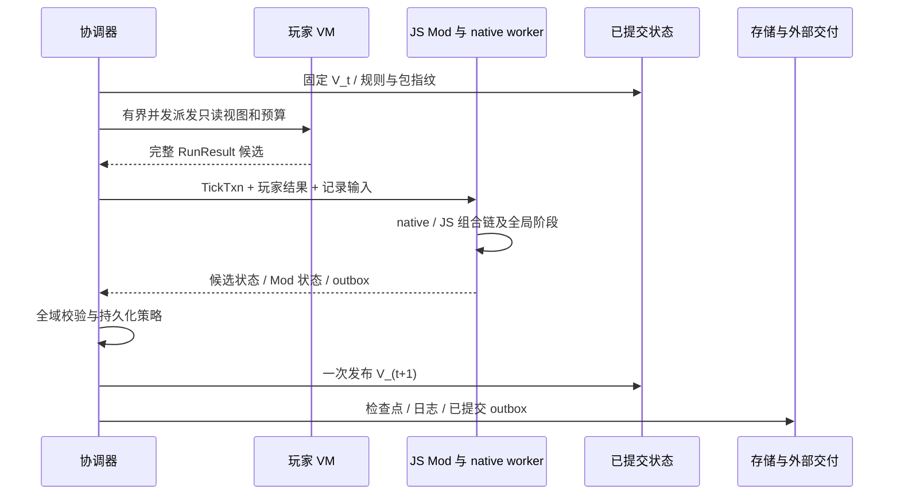

# JS Mod 系统设计

本设计要求 Mod 作者只写 JS，可以使用本项目 SDK 增加玩法或替换默认规则，不要求修改 Rust 内核或重编服务器。目标能力覆盖官方与 xxscreeps 的同类业务扩展，不承诺兼容其 Mod 源码或 Node 内部接口。

架构决策见 [ADR-014](../decisions/ADR-014-contribution-plane.md)。`kk-mod-api` 已提供独立的描述、校验和冻结入口；`kk-mod-host` 已落地装载与**注册期**（包发现/依赖拓扑/指纹/可信 realm/注册 SDK → 冻结计划，见 [C.1 记录](../research/notes/c1-mod-loader-2026-10-03.md)）；处理器执行与 Mod 状态候选域已接结算（[C.2 记录](../research/notes/c2-mod-execution-2026-10-03.md)）；Mod 声明类型的对象存储、对象域扩展意图全链（玩家面原语→收集→校验→自有槽执行）与管理创建已落地（[C.3 记录](../research/notes/c3-mod-objects-2026-10-03.md)）。玩家 API 安装（player.js/FIND/LOOK/玩家可见 Mod 对象与字段投影）与本文其余 JS API 示例仍为目标设计。技术实验位于 `spikes/`，不构成可安装的生产 Mod 系统。

B 阶段的冻结定义、有效规则、意图入口、玩家投影和首个 link 接入方案见[开放领域定义与玩家投影](domain-projection.md)。

当前 `Engine` 已将房间、玩家、市场和 ID 游标作为结算候选；A4 将 RawMemory、segments 与宿主 CPU 桶接入同一发布点，P1 已提供有界玩家派发。普通返回错误时保留提交前状态，已确认玩家结果由协调器缓存用于恢复。V8 全局不回滚，完整 Mod 状态、外部输出与磁盘崩溃恢复仍未实现；具体保证见 [tick 契约](../architecture/tick-contract.md)。

玩家在启用 Mod 的世界中应能够看到新对象与字段，调用新动作，使用新资源，体验修改后的建造、移动、战斗或经济规则，并在客户端看到相应图形和面板。服主安装 JS 包、配置后重启即可生效。未启用任何玩法 Mod 的世界继续满足 [ADR-003](../decisions/ADR-003-player-compatibility.md) 的 vanilla 兼容要求；启用后改变的规则、API 和客户端能力在握手中显式发布。

本文定义接口契约与验收要求，不把所有 API 名称视为已经冻结。审计、性能与实验依据见 [06 架构复审](../research/06-architecture-and-js-mod-review.md)；官方/xxscreeps 源码覆盖依据见 [05](../research/05-mod-extensibility-review.md)。

## 1. 能力范围与总体方案

采用 **Rust 默认内核 + 可信 JS Mod 宿主 + JS 贡献注册表 + 独立玩家 API 模块 + 客户端模块**。

- 默认规则继续在 Rust 中执行；具名注册槽位可由 JS 增加、包裹、取消或替换。无 Mod 的槽位直接走 native 快速路径。
- 新对象、动作、资源与附加字段通过 JS descriptor 注册；没有“需要新增 Rust enum 变体才能安装”的步骤。
- 玩法 Mod 以事务上下文读写候选状态；管理和外部 I/O 使用后台服务上下文。两者可以属于同一 JS 包，但不能共用玩家权限。
- 服务器玩法 VM 与玩家 VM 分离。Mod 给玩家安装的 JS 方法运行在玩家 VM 内，只有读视图和发指令权限。
- 首版在一个玩法宿主中装载全部可信 Mod，共享确定的组合链；另设后台 I/O 执行域。之后按已验证的房间隔离边界扩容。

“每个 Mod 各自隔离一个 VM”不是首版必要条件；它会让同步组合链和跨 Mod 调用需要额外协议。共同可信宿主意味着 Mod 之间不构成安全隔离边界；管理员安装的代码应被当作可信服务器扩展。玩家隔离仍必须成立。

deno_core 提供 V8 嵌入与 ops，不自动提供 Node require/npm、文件、网络和子进程。首版声明 ESM JS 模块，包内相对导入及宿主 `@kkscreeps/mod` SDK；不执行安装脚本，不在线解析漂移依赖。TS 作者可预编译为 JS，但服务器收到的是 JS。需要外部服务时使用明确的后台 SDK 或可配置 sidecar，不能承诺旧 Node 包直接运行。

### 1.1 架构约束

| # | 原则 | 一句话约束 |
|---|---|---|
| 1 | 启动合并与冻结 | 全部贡献启动时合并校验冻结为 ContributionPlan；运行期按冻结计划查找；数组索引或完美哈希等表示须按实际键与负载选择，无动态注册 |
| 2 | vanilla 走同一契约 | Rust native 是贡献契约的默认实现，不是特权路径；契约覆盖面 = Mod 能力面（具体评审约束见 ADR-014 决策 3） |
| 3 | 默认实现与扩展链 | 无 Mod 槽位走 native 直调；与当前无 Mod 构建对照测量新增成本；有 Mod 槽位才进 before/wrap/replace/after 链 |
| 4 | 三类职责分离 | 权威结算（typed + 扩展包络 + TickTxn）/ 共享投影（公共编码一次、per-viewer overlay、lazy wrapper）/ 贡献定义（纯数据、禁 V8）；投影协议一步设计、分步实施 |
| 5 | 全域候选事务 | rooms/players/market/全局 ID/Mod 状态/outbox 同一候选、同一发布点 |
| 6 | 零差异 + 显式发布 | 无 Mod 世界严格 ADR-003 红线；启用 Mod 的世界在握手中发布能力指纹 |

vanilla 默认规则也使用同一贡献契约；玩家投影协议统一设计、分步实现；首版全部玩法 Mod 使用共同可信 VM，并与后台 I/O 执行域分离。对照性能工具须覆盖本项目、xxscreeps 与官方服务器的相同功能负载，产出可比结果后才能作性能结论。

### 1.2 接口术语

| 名称 | 本文含义 |
|---|---|
| descriptor | 描述对象、字段或动作的定义，供宿主校验并生成注册计划 |
| ContributionPlan | 启动时合并并冻结的定义与处理顺序；运行中不再注册新类型或处理器 |
| EffectiveRules | 冻结后的有效规则表，默认内核与扩展使用同一份数值规则 |
| slot | 可以包裹或替换的具名处理位置，例如 source 再生 |
| TickTxn | 尚未发布的全域候选状态，失败时不改变已提交世界 |
| overlay | 叠加在公共数据上的查看者私有视图；不能包含该查看者无权读取的字段 |
| outbox | 随世界提交的待交付事件，提交后再通知外部服务 |

## 2. 包结构、装载与注册冻结

```text
mods/demo-counter/
  mod.json
  server.js          服务器注册和玩法处理器
  player.js          玩家类、getter、方法、连接器
  services.js        可选：路由、认证、通知、周期任务、provider
  client.js          可选：渲染和界面贡献
  assets/            可选：动态资产
  types.d.ts         可选：补充声明
  migrations/        可选：升级代码
```

Manifest 草案：

```json
{
  "id": "demo.counter",
  "version": "1.0.0",
  "apiVersion": "^1.0.0",
  "dependencies": {},
  "entry": "server.js",
  "player": "player.js",
  "services": "services.js",
  "client": "client.js",
  "permissions": ["game.room.write", "state.own", "assets.serve"],
  "configSchema": { "type": "object", "additionalProperties": false }
}
```

首版范围：本地目录或已经解包的版本固定包；安装、重启激活，不先实现不停服热更新。装载顺序：

1. 读取配置及包锁，校验 Mod ID/API 版本/依赖/冲突、入口路径和配置。
2. 依赖图拓扑排序；装载 server/services 注册模块。只注册定义，禁止在注册期修改游戏世界。
3. 合并常量、schema、对象/动作/能力、默认实现替换与阶段顺序；拒绝重复字段、非法覆盖、循环、未解析目标。
4. 冻结 `ContributionPlan`，包含稳定类型/字段/动作键、默认槽位、handler graph、有效规则、投影与 API 模块计划。
5. 读取世界 manifest，核对包/config 内容指纹并执行必要迁移；未装载必需 Mod 时停止可写启动。
6. 构造玩家 API bundle 和客户端能力 manifest；完成后才开放玩家和网络入口。

Mod 加载顺序不能决定持久化类型身份。指纹至少包含引擎 ABI/schema 版本、包及递归依赖实际字节、配置规范化结果、玩家/客户端源、编译产物版本；单独 `mod.version` 不足以防止同版本内容变化。世界记录激活计划指纹；缓存与共享视图也绑定该值。

注册表仅保存可校验的声明与回调句柄。函数留在对应 VM 中，不做函数跨 isolate 传输；Rust 接收的是描述数据与 handler ID。重复替换同一槽位默认报错，管理员可以显式选择所有者。运行中新增 schema/handler 首版拒绝。

## 3. 开放数据模型与有效规则

### 3.1 内建对象、扩展对象与附加字段

保留当前内建 typed 对象。新增开放扩展包络：

```text
ExtensionObject {
  id, room, x, y,
  type_key: "demo.counter/counter",
  schema_version,
  validated_payload
}
Extensions {
  object_id -> mod/field-key -> typed-value,
  room/player/world -> mod/field-key -> typed-value
}
```

包络可以由 Generic 逐步迁移，但不能继续只有任意 JSON String 和几个核心特例。字段类型先支持 bool、整数、有限数、字符串、引用、枚举、数组、记录和受限 JSON；声明默认值、可空性、长度上限、数据版本与可见性。未声明字段不能通过任意透传进入玩家视图。

每个字段的可见性至少有 public、owner、server-only；查询类型、私有集合、对象是否授房视野也独立声明。自有工地“进入集合但不授视野”等既有差异需要保留，不应把所有权直接等同于可见性。

已有 Creep/Room/Player/World 可注册命名空间附加字段；默认不改变原生 struct 布局。Mod 可以给玩家已有类增加 getter/方法，主动覆盖需声明目标与冲突，不静默抢占属性名。字段清理跟随对象销毁、跨房移动和账户删除，字段迁移与对象一起进入事务和检查点。

### 3.2 能力目录与规则槽位

对象 descriptor 声明结构类别及以下能力；native 算法通过有效目录读取，不继续依赖分散的常量白名单：

| 能力 | 需要参与的层 |
|---|---|
| owner / vision / private collection | 所有权检查、per-viewer 视图与 Game 集合 |
| FIND/LOOK、构造器与结构类别 | 玩家查询、宿主查询、包装器和类型声明 |
| obstacle / path cost / movement | 游戏移动、寻路输入、客户端地图；特殊动态障碍经 JS rule slot |
| hits / damage / repair / decay | 战斗、维修、寿命与销毁事件 |
| Store 与资源接收/容量 | transfer/withdraw/drop、建造/生产消耗、新资源目录 |
| construction / RCL / cost / placement | 工地、建造、限额、放置约束与拆除 |
| lifecycle / NPC / world spawn | 创建、前处理、tick、迁移、销毁、周期行为 |

EffectiveRules 是同一版本的目录与数值集合，生成 native 侧视图、玩家常量/API 输入及客户端说明。简单值可声明覆盖；条件行为由 JS 实现。资源名使用稳定命名空间，Store 已有扩展项可以作为数据起点，但所有校验、容量、生产与交易通路都必须读取有效目录。

EffectiveRules 冻结后必须生成**平坦形态**的 native 视图（排序数组/定长 struct/函数指针表，例如建造成本表 → 按稳定键排序的定长数组），减少结算热路径的动态查找。其成本须与编译期常量方案测量对照，不能仅凭数据布局宣称相同开销。寻路层（kk-pathfinder 为官方 C++ FFI 黑盒）改地形/成本规则的 Mod 须经显式 wrapper 槽位（Rust CostMatrix 回调接口已有，玩家通道尚未接入），不能假设 Mod 可直接改写寻路输入。

保持 Rust 表示安全的约束（坐标、ID 唯一性、索引一致、字段编码合法）与 vanilla 玩法约束分开。Mod 替换了成本/目标/伤害规则后，宿主不能又在隐藏的另一层按 vanilla 规则拒绝。若需要改变原生类型不能表达的值域/表示，允许为该业务类型提供扩展表示和 JS 默认处理/投影替换；不能强制作者修改 Rust 字段宽度。此能力成本高，单独验收，不把扩展表示直接喂给假设旧布局的 native 处理器。

Mod 不获得 Rust 裸指针。位置、归属、生命周期、Store 与字段改变通过可组合的事务服务操作；提供声明字段的低层 patch 和读取完整候选域的可信接口作为兜底。低层 patch 也要维护索引、脏标记和派生失效，不能变成到处手写同步的第二套世界。

## 4. 开放指令协议

默认动作保留静态解析优化，新增 `ExtensionIntent {intent_key, target_id/room, validated_args}`。内部紧凑整数句柄可以使用冻结计划分配，但磁盘身份以命名空间键/manifest 字典为准。

每个 IntentDescriptor 同时声明：

- 对象/房间/玩家/世界作用域及允许接收类型；参数 schema、字段清洗与长度上限；
- 授权与所有权策略、目标能力和可信宿主 validator；
- 同动作最后覆盖或有界队列、每 tick 限额、意图计费；
- 冲突组与阻塞关系；执行阶段、before/after 约束与 JS handler；
- 玩家方法及返回码语义；原始 action override 是否允许及所有者。

完整链是 **玩家方法 → 收集器 → RunResult → 宿主身份绑定和清洗 → 授权 → 调度 → 候选状态**。调用者身份由 runner/协调器绑定，不能从 payload 相信 `owner/user`。未知动作继续丢弃，只有冻结目录中的扩展动作可进入；不提供无校验的任意 JSON 执行后门。

简单参数/枚举定义生成两侧检查；复杂玩家预检和权威执行必须分别验证。前者为了即时错误码，后者以当时候选世界为准；同 tick 竞争引起的执行失败是正常语义。玩家可污染原型和伪造收集数据，宿主必须独立检查。Mod 的服务器处理器可以拥有改变任意对象的授权，但这不等于玩家有同等授权。

## 5. 默认处理器与 hook 组合语义

至少提供三类入口，不能只提供提交后事件：

1. `observe`：只读已提交状态，通常用于统计与后台输出。
2. `before/after/wrap`：围绕当前槽位处理链，读写候选事务。
3. `replace`：占有一个默认实现槽位，可以完全省略默认逻辑。

槽位应覆盖动作处理、对象 preTick/tick、房间阶段、世界阶段；再细化到移动资格/争议仲裁/疲劳、伤害累积/最终应用、建造放置/成本、容量、视野、NPC 生成、市场与跨房传输等业务规则。只开放 `room.tick.after` 无法完整替换这些算法。核心阶段列表和 slots 应有覆盖清单，随着默认内核逐块迁移补齐。

组合约定：before 正序；wrap 按拓扑序形成外层→内层链；最内为 replace 或 native default；after 按约定逆序回收。`next()` 在同一候选、对象和动作上下文中继续内层，默认只允许一次；不调用 next 表示取消内层。after 只在相应内层成功返回时运行；回滚清理用单独宿主流程，不让 finally 把失败候选发布。

依赖/阶段 before/after 是图约束，不能用单一 priority 数字覆盖一切。循环、越过强制阶段边界、同槽位多 replace、引用不存在的 handler 在启动时报错。所有约束缺省用稳定 Mod ID/handler ID 排序；完成顺序与 hashmap 迭代不得参与玩法语义。

首版玩法 callback 必须同步返回，返回 Promise 视为注册/执行错误；不能 await 文件或网络。允许 JS `next()` 同步调用 native、native 再触发生命周期 JS，但所有此类 op 必须显式 reentrant，且进入 JS 之前释放 OpState/事务借用。这条交互已由[实验](../../spikes/deno-spike/examples/js_mod_host.rs)在 debug/release 验证，真实 native 处理器尚待按此重构。

## 6. 宿主实现与所有权

### 6.1 推荐依赖方向

`kk-mod-api` 保存纯描述与计划；`kk-engine` 保留内核、候选和 native handlers；`kk-mod-host` 封装 JS 装载、ops、回调和后台调度；`kk-runtime` 管理提交、玩家任务和宿主生命周期。当前 `kk-engine` 不依赖 deno_core；`kk-mod-api` 已建立独立 crate，`kk-mod-host` 已实现注册期（装载/依赖图/指纹/可信 realm/注册 SDK；结算期回调与 ops 未接），默认处理器和投影消费冻结计划的接线仍待完成。

### 6.2 先建立 OwnedTxn，再接入 VM

引擎已建立拥有输入、房间、市场和共享状态的 `OwnedTickTxn`。`Working<'w>` 通过 `TickState` 短暂访问玩家候选和 ID 游标，但仍局部借用 room，不能直接放进生命周期要求为 `'static` 的 OpState。接入 VM 时由同一宿主线程的 native 和 VM 持有拥有数据的候选事务，通过 `Rc<RefCell<OwnedTxn>>` 或等价安全封装取得短暂访问；在进入 JS 前结束房间与事务的可变借用。

```text
runtime 收集玩家结果 + 原 TickInput
    -> 准备拥有数据的 TickTxn
    -> 移交给玩法 worker（JS 与 native 内核同线程）
    -> 在冻结计划下执行阶段和 handler 链
    -> 校验候选、生成发布结果
    -> 交回协调器一次发布
```

不按每字段 channel 往返。native 修改期间只借用候选；需要进入 JS 时结束借用，将 ID/参数/回调句柄传入；返回后重新查找对象和代际，不能继续使用可能被 JS 删除/移动的旧对象引用。这使事务借用与进入 JS 的边界明确；再入调用仍须检查借用、对象失效和错误传播。

已有长函数不能在持有 `&mut Working` 时插入任意 JS 回调；需要分成可恢复的 native 步骤，或在回调边界提取 owned 数据并结束借用。不要使用 unsafe 指针或 lifetime transmute 规避这项改造。嵌套链设置最大深度与 next 单次守卫，错误向最外层候选执行传播。

### 6.3 数据访问采用多种粒度

低频事务命令可用宿主 ops；满足 fast op 签名与重入约束时再选择 fast 调用；热读使用当前候选的本地 view/惰性对象；密集更新可用 typed columns 与有界 patch。公开 SDK 可以统一语义，但底层不必只有一种传输形式。

本地 overlay 必须让后续读取看到本轮此前的写入；进入 native next 前 flush/校验脏 patch，native 返回后按 mutation epoch 失效或刷新相关 view。native 内的 JS 生命周期回调也要看到最新候选。新对象创建、删除、跨房移动都会失效相关目录；不能拿预 tick 全量 JSON 处理完所有 Mod 再统一覆盖 native 中途修改。

先实现安全、可观测的直接命令路径，再比较实际 getter/patch 的开销。实验中 serde_v8 全数组复制并非始终快于 fast ops，不能据此硬选 JSON batch；更不能把可信 Mod 的访问方式直接当作玩家字段读取方式。生产测量记录 op 次数、转换字节、进入 JS 次数、分配/GC、native fallback 和 P99。

## 7. 全域事务、确定性与恢复



TickTxn 包含 rooms、players（Memory/segments/CPU）、market、全局 ID、Mod 状态、瞬态字段与待交付事件。提供事务内对象/房间/玩家/世界状态 namespace；Mod 的伤害、移动等中间量可放 transient namespace，内建中间量经声明的领域服务读写。只开放最终对象字段会遗漏官方 processor 中跨阶段暂存的能力。

当前市场已通过 `market_cand` 参与结算，后续校验或发布阶段返回错误时不会修改已提交市场。这项保证仅针对当前返回错误的路径，不包括发布中的 panic，也不包含尚未接入的 Mod 回调、持久化或 outbox。新增可失败阶段须维持所有已提交域不变。

Mod 玩法数据必须使用 `ctx.state`，模块全局只允许定义和可重建缓存。JS 堆不随 Rust 候选回滚；失败后销毁/重建玩法 VM，从同一已提交状态、同一输入重新计算，或复用完整候选结果。不能依赖模块级 counter 作为权威状态。需要验证冷/热 VM 对同状态同输入结果一致，重试/回放 hash 一致；这是一项作者契约，无法自动把任意 JS 全局变化变成事务。

玩法 realm 提供由 TickInput/RNG 域驱动的时间与随机 API；捕获的 Date/Math.random 也必须一致，不能只新增 `ctx.now` 却保留真实时间/系统随机供规则读取。计时诊断、定时器、crypto 随机与外部服务只放后台域；tick callback 不运行其 event loop。RNG 域、遍历序和每轮重置规则需要持久化输入/种子与明确测试。

管理员命令、周期任务和外部响应若改变玩法，进入带身份与序号的输入队列；首版在结算阶段产生 V_(t+1)，玩家仍读已固定 V_t。需要在下一轮玩家执行前改变配置或规则时，通过独立边界命令更新规则 epoch 并重建相关 bundle；不在一轮中途改变常量目录。初始化/地形生成在开始游戏前执行，另有版本化结果。

异常、超时、无效 patch 或未授权域写入默认使本轮候选失败并进入恢复，不自动跳过 Mod 然后提交不同规则的世界。管理员可在边界禁用并迁移 Mod，变更记录在输入/manifest 中。纯 JS 无限循环可被 V8 terminate；阻塞 native op、内存失控和进程崩溃需要进程级恢复，不能保证仅靠线程内捕获解决。

检查点以 manifest 原子发布，包含所有域与 Mod 指纹；若只定期落盘，明确 RPO。追求完整恢复时，输入日志还需记录玩家输出与持久状态候选、管理员/外部输入和 Mod 状态变化；恢复不重新执行玩家脚本。日志/持久化/内存发布顺序按所选耐久策略定义并故障注入验证。

外部通知/HTTP/邮件先写候选 outbox，成功提交后交付。幂等键含 shard/tick/mod/event ID；失败重试，不能无条件承诺外部 exactly-once。提供提交后最佳努力观察回调也可以，但要明确它不改变已提交玩法。

## 8. 玩家 API、快照与编辑器

server 注册对象/schema/动作后，player.js 独立安装类、字段 getter、原型方法、常量、FIND/LOOK 和 Game 集合。装载发生在核心注册关闭与构造器捕获之前；不要开放内部 `__kkp` 给玩家或 Mod 作为公共接口。

投影协议**一步设计到位、分步实施**：共享公共二进制编码（每房间每 tick 编码一次，乃至仅脏房间）、per-viewer 只读 overlay（memory/可见性裁切/市场视图）、lazy wrapper 按需读字段、扩展字段目录与 variable arena 预留——这四件事是同一个协议，不是四个独立优化。它同时服务于减少重复编码、共享字节和按权限过滤的目标；惰性字段读取减少提前创建的 JS 值，但包装器、索引和缓存仍有内存成本，也是 ADR-004 决策 1「共享内存直读 + 增量通道」的具体收敛形态。按 ADR-014，协议应统一设计后分步实施；过渡期 JSON 通路继续用于行为对照，不重复设计互不兼容的玩家协议。

player.js 从可信 Mod 包加载，在每个玩家 VM 中执行，函数与构造器在该 VM 内生成；不能把服务器 VM 的函数序列化进去，也不能只取 Function.toString 而丢闭包依赖。需要可版本化的玩家模块加载器和 SDK，允许依赖公开内建类。安装后捕获可信注册数据/入口，隐藏宿主控制句柄；玩家后续原型污染不得影响宿主权限和清洗。

getter 从本轮已授权投影/只读视图取值，不每次请求服务器。字段 public/owner/server-only 已在宿主裁切；玩家不能拿到整房 buffer 再在 getter 隐藏机密字段。共享公共编码、私有字段 arena 或 owner overlay 应在同一代际绑定。

二进制视图为扩展类型预留稳定目录、字段表与 variable arena；内建 u8 tag 不被 Mod 抢占。getter 按 id + 当前代际查找，保留既有旧引用与可见性语义。扩展目录、有效规则与 API bundle 指纹变化时失效缓存；首版停服升级并重建玩家 VM。

根据 descriptor 生成基础 TypeScript 声明，包内 types.d.ts 补充自定义方法。SDK 版本、类型声明与玩家/编辑器暴露能力一致。新 FIND 数值由 registry 分配后写入 manifest；Mod 在 player 模块取注册常量，不硬抢全局整数。

## 9. 一个贯穿全链路的 JS 包示例

以下是**拟议公共 SDK 形状**，不代表仓库已有这些方法。真正可运行的技术实验见 [js_mod_host.js](../../spikes/deno-spike/examples/js_mod_host.js)。

```js
// server.js
export default function register(api) {
  const type = api.objects.define('demo.counter/counter', {
    base: 'Structure', version: 1,
    fields: { value: { type: 'i32', default: 0, visibility: 'public' } },
    capabilities: {
      owned: true, obstacle: false,
      find: 'demo.counter/FIND_COUNTERS', look: 'demo.counter/counter'
    }
  });
  api.intents.define('demo.counter/increment', {
    scope: 'object', targetTypes: [type], ownership: 'owner',
    args: { amount: { type: 'i32', min: 1, max: 10 } },
    mode: 'replace-last', phase: 'object.intents',
    process(ctx) {
      ctx.objects.update(ctx.targetId, fields => {
        fields.value += ctx.args.amount;
      });
    }
  });
  api.handlers.wrap('object.tick.source', {
    id: 'demo.counter/source-audit', scope: 'room'
  }, (ctx, next) => {
    next();
    ctx.state.room.increment('sourcesProcessed', 1);
  });
}
```

```js
// player.js
export default function install(api) {
  const { Structure } = api.builtins;
  class Counter extends Structure {
    get value() { return api.view.field(this, 'value'); }
    increment(amount = 1) {
      return api.intents.emit('demo.counter/increment', this, { amount });
    }
  }
  api.objects.bind('demo.counter/counter', Counter);
  api.globals.define('Counter', Counter);
  api.queries.install('demo.counter/FIND_COUNTERS');
}
```

`emit` 的 SDK 根据 descriptor 和对应预检返回错误码；宿主仍独立验证。fields updater 使用事务 draft，结束即校验/标脏，不把 Rust 借用持续给 JS。`ctx.state.room` 自动位于当前 Mod 的 namespace。以上 source wrap 只观察默认处理后的计数，不暗示可以通过同一示例改变再生规则；替换 source 行为需要 replace 或更具体的 regeneration slot。

验收时通过管理命令创建 counter，玩家 FIND/getObjectById 读值、increment 发合法指令、Rust/JS 宿主更新候选、下一 tick 值变化、UI 显示、保存重启保持。另用一个 Mod 替换既有 native 行为，防止系统只能扩展自己的新类型。

## 10. 网络、存储、管理和客户端能力

这些也必须是 JS 可贡献面，不作为未来 Rust 插件的保留区：

| SDK 域 | 宿主实现要点 |
|---|---|
| HTTP routes/middleware、WS subscription | Rust 网络层解析、限流与排队；后台 JS 返回响应/订阅数据；身份上下文不可伪造，写游戏状态发边界命令 |
| auth、notifications、messages 等 provider | 具名业务接口和 fallback；单槽位替换冲突检查；JS 可完全替换策略/业务实现 |
| admin commands、cron/task、世界生成 | 参数 schema、身份与队列；玩法结果记录输入；世界生成可用 JS 实现并版本化地形/初始状态 |
| Mod 命名空间存储 | 玩法状态包含在 TickTxn；后台 KV/对象存储另有 async API，不能拿它绕过游戏提交 |
| checkpoint/底层 storage provider | JS 实现读写 block、读取/发布 manifest、耐久与校验接口；在异步持久化工作域执行；引擎不依赖具体 DB；atomic publish 能力经故障验收 |
| renderer/assets/details | 动态资产目录、对象图形/动画/文字、详情 schema；复杂效果加载管理员安装的客户端 JS 模块 |
| UI pages/menu/widgets、编辑器 types | 客户端 SDK 与注册顺序；服务端能力/内容指纹握手；默认嵌入前端不意味着每个 Mod 都重编二进制 |

底层 JS storage provider 会比 native 存储接口付出额外跨域/序列化开销，但应允许实现；目标默认后端由 Rust 实现；当前存储 crate 尚未接入持久化。通知/邮件等集成可以使用后台 fetch、文件或受权限控制的宿主服务；阻塞游戏线程的同步外部 I/O 不属于首版玩法契约。

服务端任务的模型可是一组实际业务 API，而不必模仿官方 Mongo 查询对象。需要新的业务域时增加 JS 服务契约；只给只读事件、不允许替换认证/存储等实现不能算完整覆盖。

客户端握手包括 mods、api/schema/config/content 指纹、对象/动作/资源能力和资产 manifest。自建 Vue/Pixi 客户端显示 Mod 内容与官方客户端显示 Mod 内容是独立测试面；若要求官方客户端也显示，应另接官方 customObjectTypes/renderer 配置协议。自建 Mod API 不妨碍协议适配，不能把自建客户端成功自动算作官方客户端成功。

## 11. 迁移、卸载、并行与性能边界

迁移以旧版本读视图和新版本事务进行；顺序由依赖与数据版本决定，校验后整体发布，失败保持旧 manifest。必需 Mod 缺失默认拒绝可写启动，允许显式只读恢复导出；不把未知对象默默当 Generic 丢行为。卸载需要 dependent 检查和有声明的 remove/export/convert 数据处理。ID/tag/字段键不可复用。

首版使用完整世界的串行候选，允许规则读取和修改其授权域；可表达的规则仍受 SDK、数据表示和资源预算约束。后续 scope 分 room/player/world，声明只读/可写域；宿主检查实际访问。room scope 限当前房及自己的房间状态，跨房/账户写通过明确命令/差异汇总；world scope 进入串行屏障，仍有完整能力。未声明不意味着自动隔离成功，不能只相信作者填写 `parallelSafe: true`。

当前 `TickState` 通过同线程 Rc/RefCell 共享玩家候选和 ID 游标，房间仍串行结算；这不是跨线程调度接口。并行新对象 ID 可以采用预分配稳定区间或带映射的临时 ID，必须处理同轮引用/返回值和最终改写；native vanilla ID 次序按兼容测试选择。玩家 GCL/credits 等非交换更新需要串行排序或领域专用合并，不能全部做求和。跨房移动、终端发送和市场归全局阶段。

性能必须验收：

- 无 Mod：默认 native 快速路径与当前构建对照，报告新增注册检查/内存成本；
- 简单 Mod：只命中一种稀少对象；高密度 Mod：大量对象读写；规则 replace/wrap：真实 native 组合链；
- 同房多玩家、100 玩家、大对象房、世界级 Mod、Mod 多包依赖；
- CPU/RSS/分配/GC/复制字节、op/回调数量、wall P50/P95/P99、超时恢复；
- 同初始状态同输入输出一致，功能工作量相等，≥5 独立运行，正式样本窗口遵守性能验收。

实现中另须验证以下要求：

- **可比性能**：本项目、xxscreeps 与官方服务器使用相同初始状态、玩家代码和功能工作量，至少 5 次独立运行；指标范围见[性能验收](../architecture/performance-acceptance.md)。未完成的对照必须说明缺项，不能用功能更少的负载证明性能优势。
- **V8 启动快照**：应验证将 prelude 和 lodash 预编译产物放入启动快照的方案。当前玩家沙箱仍执行启动脚本；实验中的恢复耗时不等于生产玩家重建耗时，也不能证明整机内存更低。
- **计费与并发**：当前玩家计费使用墙钟，协调器逐玩家等待回执。有界并发与线程 CPU 计费是目标改造，须同时验证预算口径、超时保护和结果顺序，墙钟看门狗仍用于活性保护。

预算分成每轮 JS 处理时间、堆/外部缓冲、最大 patch/事件数、后台并发与队列。共用 VM 的内存不能可靠逐 Mod 归因；首版给宿主总限额，报告当前 handler/Mod ID 和耗时。需要强隔离或逐 Mod 资源账本时再拆进程/VM，不假定一开始已具备精确隔离。

## 12. 能力验收矩阵

全部通过前不得声称“官方能做的 Mod 我们都能做”。参考官方[自定义指令对象](https://github.com/screeps/launcher/blob/master/init_dist/example-mods/custom-objects/intent-custom.js)、[取消默认对象行为](https://github.com/screeps/launcher/blob/master/init_dist/example-mods/process-object.js)及 [Community Servers](https://docs.screeps.com/community-servers.html) 的功能口径；xxscreeps 的本地路径见 05 证据表。

| 场景 | 最低可观察通过条件 |
|---|---|
| 自定义 counter 全链路 | JS 注册对象/字段/FIND/LOOK/类/动作/处理器/UI；不改 Rust 核心；双玩家权限与重启保值 |
| 内建行为替换 | JS 包裹 source 再生、取消 NPC 默认生成或修改 link/rampart 规则；没有二次 vanilla 硬编码否决 |
| 已有对象和 Room/Player/World 扩展 | 附加字段有权限投影、事务存储、清理和版本迁移；模仿 xxs Room stats |
| 新资源建筑 | 可建造、挡路/寻路、可受击维修、存取新资源、容量、生产、客户端图形全部连通 |
| 移动/战斗/经济规则 | 替换冲突仲裁/伤害应用/市场全局逻辑之一；跨房/账户读写和瞬态阶段正确 |
| 玩家 API 与传输 | 给内建类加方法/全局类/连接器；新动作宿主清洗；敌人/伪造身份/原型污染不能越权 |
| 管理和外部集成 | JS 管理命令、周期任务、HTTP/订阅与通知 provider；游戏修改记录输入、通知 outbox 重试 |
| 认证与存储替换 | JS 替换 auth/message 或 storage provider；恢复只接受完整已发布 manifest |
| 地图/NPC/世界规则 | JS 地形/初始化及世界级 tick；同 seed/input 确定，world scope 可关闭房间并行而不丢能力 |
| 图形/详情与复杂 UI | 动态贴图、文字动画、详情面板和客户端 JS 模块；类型/资产指纹握手 |
| 多 Mod 组合 | 依赖稳定、wrap 次序可解释；重复 replace/字段或顺序循环启动拒绝 |
| 失败、恢复与升级 | 第 N 房/全局/嵌套回调异常和超时无部分提交；VM 重建、冷/热一致；缺失 Mod/升级失败保旧版 |
| 大规模与默认兼容 | 无 Mod 棘轮零回归；真实 workload 的 CPU/RSS/P99 与官方/xxs 同功能对照 |

无法用有限 API 保证复现任意 Node 内部 monkey patch 或原生实现漏洞。本项目的承诺是完整业务功能与默认规则替换，发现未覆盖领域就扩展 JS 契约，不能把“改本项目 Rust 源码”计作已支持的 Mod 能力。这一点应在 Mod API 文档和版本变更规则中明确。

## 13. 与架构及实施计划的关系

本文件定义 Mod 作者可获得的能力、组合行为、事务边界和验收要求。具体拆分与顺序集中维护在[贡献平面实施计划](../plans/mod-plane-batches.md)，避免设计文档重复保存任务清单。

新增封闭类型分派或硬编码玩法规则时，按 [ADR-014](../decisions/ADR-014-contribution-plane.md) 的评审要求提供具名槽位、有效规则数据通道，或登记明确的过渡范围。默认行为迁移须保持兼容性门禁，并验证规则替换不会被另一层隐藏的 vanilla 检查否决。
