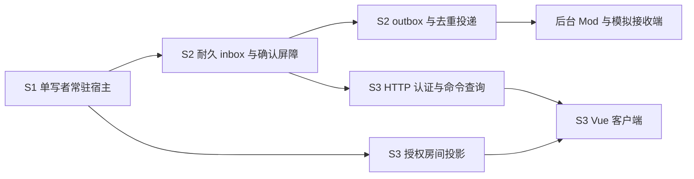

# 常驻服务、耐久命令与可登录客户端三批方案

- 属性：目标设计与实施拆分；2026-10-12 用户选择本功能方向，尚未实现。
- 设计基线：HEAD `99cb63c6`；实际进度、验证与接手位置只维护在[任务台账](mod-next-batches.md)。本文的类型、命令、端点和默认值均为拟议接口，不能作为现有使用说明。
- 目标：同一固定世界中，两名玩家持续运行、重启续跑、登录、更新代码、执行控制台命令并观看房间。
- 依据：[完整玩法计划](mod-complete-gameplay.md)、[ADR-014](../decisions/ADR-014-contribution-plane.md)、[ADR-017](../decisions/ADR-017-background-services.md)、[ADR-018](../decisions/ADR-018-production-persistence-posture.md)；命令确认与回滚的取舍见[ADR-021（拟议）](../decisions/ADR-021-service-command-durability.md)。

## 1. 交付与范围

| 批次 | 可使用的成果 | 对应任务 | 明确保留的缺口 |
|---|---|---|---|
| S1 常驻与恢复 | 启动固定世界，自动推进、周期保存、停止保存、无日志重启续跑 | G26.a 服务接线，G27.b/G28 的准备 | 没有玩家网络写入、outbox 或可登录客户端 |
| S2 耐久输入与输出 | 已接收命令可在崩溃后找回；代码更新、表达式和 Mod 输入在受控边界消费；外部输出只在耐久后投递 | G27.b，G20 的受限输入消费者 | 不等于完整玩家/世界生命周期、JS storage provider 或任意外部 I/O |
| S3 登录与房间客户端 | 两玩家登录、上传模块、执行表达式、观看房间、断线重连与重启重同步 | G28.a/G29.b 首片 | M3 的官方客户端连接另验；完整账号运营、世界地图、市场、回放和客户端贡献仍未完成 |

这三批不恢复 50×6 性能主线或 renderer R7 长测，不改变 M3/M5 的完整验收范围。固定地图与服主预建玩家足以验收这次闭环；地图生成/G21、注册与殖民选址另拆。服务与 UI 的短负载、队列限额、恢复峰值仍须验证，属于功能正确性和资源有界性检查。



## 2. 源码基座与模块责任

| 已有基座 | 能复用的部分 | 实施前必须补的边界 |
|---|---|---|
| [EmbedEngine](../../crates/kk-runtime/src/embed.rs) | 玩家轮次、失败缓存、世界/Memory/CPU 提交、模块表、检查点 | 同一所有者线程创建/调用/销毁；不把内部 Rc/V8 塞进 axum 共享状态 |
| [检查点文件发布](../../crates/kk-runtime/src/checkpoint.rs) | 256MiB 上限、哈希信封、文件同步/rename/父目录同步 | 本地文件能力可提取给 storage；发布确认、目录所属权与筛选不能照搬 sim |
| [sim 周期保存](../../crates/kk-cli/src/sim/auto_checkpoint.rs)、[恢复选择](../../crates/kk-cli/src/sim/checkpoint.rs) | 保存/清理思路、故障用例 | 目录恢复依赖输入日志，CLI 身份绑定场景/模块目录；不适合原样用作服务恢复 |
| [工作者模块替换](../../crates/kk-runtime/src/executor.rs)、[Sandbox 模块替换](../../crates/kk-runner/src/sandbox.rs) | 模块格式与装载机制 | Sandbox 先替换模块再重置缓存，失败不回滚；需新增准备替代工作者的事务接口 |
| [后台服务](../architecture/background-services.md) | 独立线程/V8、队列、预算、命名只读探针 | 尚无耐久写能力；输入、输出必须使用宿主显式授予的能力 |
| [RoomFeed](../../packages/shared/src/feed.ts)、[FeedStore](../../packages/renderer/src/feed/room-feed.ts) | 快照/增量、RoomVisual、已有 renderer | feed v0 不是已冻结网络协议；delta 必须有递增时间，快照会清除瞬态/visuals |

拟议职责：

- `kk-runtime::service`：持有引擎的单一执行者、调度、命令边界、服务事务、暂停/恢复、已提交视图；依赖存储接口，不依赖 HTTP。
- `kk-storage`：有界字节/JSON 信封的原子文件发布、目录租约、检查点清理、inbox/fence/投递确认文件；不解释游戏规则，不依赖 runtime/V8。从 runtime 提取发布原语时保留原公共检查点 API 和现有测试。
- `kk-backend`：HTTP/WS、认证、限流、订阅和 DTO；通过 `ServiceHandle` 请求宿主，不能持有可变 World 或直接改玩家状态。
- `kk-mod-api`/`kk-mod-host`：冻结命名输入/输出描述、schema 和授予能力；后台只提交脱离世界的数据。
- `kk-cli`：参数、初始化、配置、信号与组装。`sim` 和 `serve` 共用机制，各自保留身份和恢复政策。
- `packages/shared`：生成的网络 DTO 与既有渲染数据类型分目录；`api` 管传输/重连；`editor` 管代码；`apps/game` 组装；renderer 保持独立。

`ServiceHandle` 只发送有界请求或读不可变发布视图；命令接收队列、管理队列、订阅发送队列分别限额，停止信号不排在普通请求洪峰之后。同步引擎和文件写入不占用网络异步执行器。首版在 tick 边界同步保存，避免多份世界快照排队；异步保存不是这批前置。

### 状态归属与恢复真相源

| 状态 | 所有者/权威保存位置 | 恢复政策 |
|---|---|---|
| 世界、Memory/segments/CPU、模块字节、Mod 状态 | 既有 EmbedEngine 完整检查点 | 同版恢复，保留既有身份门 |
| worldId、publishSeq、种子/内容身份、每玩家入口模块 | S1 类型化 `metadata.service` v1 与目录 identity | init 后不从种子文件重置；保存每个 bot 的实际 entry，不能一律假设 main |
| 已接收命令、流生命周期/received 水位、nextServerSeq | S2 inbox 最新原子状态 | 不随游戏回滚；未消费原载荷保留 |
| consumedServerSeq、流 applied 水位、codeVersion、结果窗口 | S2 同版 `metadata.service` v2 | 随游戏检查点一起恢复；无输入重放时也能判断命令是否已应用 |
| pending outbox、nextOutputSeq、屏障身份 | S2 同版 `metadata.service` v2，输出先在候选中产生 | 随已提交世界恢复；不得保存失败候选 |
| 恢复下限、各 sink delivered 水位 | S2 effects 最新原子状态 | 独立保存、不回滚；决定可选检查点和重发过滤 |
| 玩家密钥/授权与撤销版本 | S3 credentials 独立严格格式 | 不回滚；只能映射到当前世界存在的预建玩家 |
| 会话、订阅、差分缓存、runEpoch、visuals、普通 console 环 | 进程态/有界视图 | 重建；不冒充耐久历史 |

恢复和清理必须校验：`effects.minConsumed ≤ checkpoint.consumedServerSeq ≤ inbox.receivedServerSeq`；每流 applied 不超过 received；outbox 的 ID/分配游标与 sink 水位合法。新的消费水位只推进完整 FIFO 前缀，不能跳过未终结命令。结果与 payload 摘要窗口分别有上限，写满时保留水位，过期明细不能重造执行。service 新域独立键树/版本测试，不受既有 metadata 不透明处理自动保护。

## 3. S1：常驻运行与无日志恢复

### 3.1 启动、配置与身份

拟议命令（实现后再补可执行示例）：`serve init --config <file> --seed-scenario <scene>` 和 `serve run --config <file>`。S1 可不监听网络；S3 使用同一宿主增加监听器。初始化须显式执行，运行时发现空/坏目录不能静默创建新世界。复用现有配置编码工具，首片服务配置采用严格版本化 JSON，不为本批另引入一套配置语言。

初始化复用场景解码/装载机制，产出包含实际世界、玩家模块/预算和 Mod 身份的初始检查点。场景断言/alias 不变成服务运行配置。init 写入完成标记之前发生崩溃，run 拒绝半初始化目录，原输入不被改写。之后玩家代码来自检查点及 S2 命令；重启不重新读取种子场景覆盖 Memory 或玩家模块。

| 配置 | 拟议默认与约束 |
|---|---|
| tick 间隔 | 1000ms；正整数、以单调时钟调度，不用游戏时间计算 sleep |
| 玩家并发 / 通道 | 2 / KKPV；JSON 保留测试与诊断通路 |
| 玩家堆 | 64MiB，沿用当前宿主限额；恢复以保存的工作者配置为准 |
| 自动保存 | 每 60 个成功 tick 或距上次耐久保存 60s，两者先到者；无状态变化不反复写相同版本 |
| 保留 | 最近 3 个完整版本；S2 另固定保留恢复下限引用的锚点 |
| 审计输入日志 | 默认关闭；首片仅支持无日志运行，显式审计/轮转另切片，不因常驻服务改为默认开启 |
| 退出等待 | 拟议 10s，可配；报告是否保存成功，不把强制退出写为优雅退出 |

这些数值是功能开发初值，不是 50 玩家/2GB 容量结论。CPU limit/bucket 首版沿用保存的工作者配置，运行中不任意修改。tick/监听地址/保留数量属于操作配置；seed、世界身份、预算、内容选择及计划属于世界/执行身份。内容与协议变化仍走既有硬门或显式迁移；服务元数据另有 `service_format_version`，不以 CLI 可执行文件哈希作为唯一恢复门，也不删除 engine/schema/Mod 身份检查。

### 3.2 调度与停止状态机

生命周期为 `Starting → Running → Draining → Stopped`；结算/基础设施故障进入 `PausedFault`，发布耐久性不确定进入 `PersistenceFault`。错误状态拒绝新的写命令，保留只读状态和诊断。S1 的本地控制先由 `ServiceHandle` 与可选 `--control-stdio` 逐行 JSON 入口提供 status/retry/stop；进程持有者是管理主体，不开放未认证网络端点。S2 可经同入口验证命令受理/查询，S3 复用其命令核心。

所有注册玩家每轮运行一次，包括无网络连接的玩家；无玩家也按引擎规则推进世界。每次运行结束计算下一次截止时间：尚未超时则等到原截止点，已超时则从当前时刻延后一个间隔。过载降低实际 tick 速率，不跳过游戏 tick，也不突发补跑墙钟积压；停止重启不补算停机期间的拍。[Tokio 默认 interval 会补发积压](https://docs.rs/tokio/latest/tokio/time/enum.MissedTickBehavior.html)，因此不能沿用默认 Burst；即便采用 Delay，也要用调度测试锁定上述策略。

- 玩家异常/CPU 中断：沿现行玩家结局语义结算并发布错误，其他玩家继续，不能按 sim 的“玩家错误终结整场景”政策停服。
- 结算失败：保持 tick，暂停；显式重试只消费现有 RunResult/TickInput 缓存，不重新运行玩家或重新挑选命令。
- 玩家线程/协议故障：暂停并保留已确认结果；首版不盲目自动重派。重建沿用现有恢复门，管理重建/放弃需显式记录。
- 停止：先关闭写入准入，不开始下一拍；完成在途可结束的轮次，确认无开放/失败轮后保存，再关闭后台/玩家线程。存在失败轮时不擅自 discard，退出非零并报告最后耐久 tick。

永久阻塞的 native 调用仍可能使 join 无界；10s 是宿主发出超时状态的目标，不承诺强杀单个 Rust 线程。进程级强制终止由监督器处理，M5 隔离另验。

### 3.3 保存、单写者与恢复

服务状态目录与玩家/Mod 输入目录分离。拟议布局：

```text
state/
  writer.lock                 固定 inode，持锁期间不删除/替换
  identity.json               初始化完成标记、worldId、服务格式
  checkpoints/cp-<publishSeq>.json
  inbox.json                  S2：有界最新 inbox 状态
  effects.json                S2：恢复下限与投递确认
  credentials.json            S3：独立账号凭据/撤销版本
```

用固定文件的 OS 独占锁持有整个会话；第二进程立即拒绝，不凭 PID 判断“旧锁”。锁文件不得在持有期间 unlink，否则另一个进程可能锁到新 inode。[Rust File 锁的行为有平台差异](https://doc.rust-lang.org/std/fs/struct.File.html#method.try_lock)；首片验证 macOS/Linux，本地文件系统之外的耐久/锁保证不默认成立。

保存只捕获无开放轮次的完整状态。文件名按发布序号而非游戏 tick 排序，为 S2 的同 tick 代码更新预留空间；发布序号由目录中已发布版本核对后分配，不因回滚重复使用。有效载荷须包含 worldId、publishSeq、tick、服务格式和运行身份，文件名不是身份真相源。

发布顺序沿既有协议：同目录新临时文件 → 完整写入 → 文件同步 → rename → 父目录同步 → 才记为成功。读取限额与峰值保留现有约束；新建目录的父目录同步也须验收。清理只在新版本耐久成功之后做，不跟随时间删除仍在使用的锚点。已存在目录中可保存、恢复后继续保存，不沿用 sim 的“恢复输入目录不能同时为输出目录”策略；用服务目录租约和固定内部路径替代这一守卫。

恢复先验证目录/世界身份，再按发布序号降序读取。文件撕裂或哈希损坏可记录并跳过；权限/I/O 故障、未来格式、内容/协议/Mod 身份不匹配必须停止，不能以“坏文件”为由静默退到另一个规则版本。每个候选只建立一个替代引擎，成功后切换；失败不改原文件、不执行未核验的玩家/Mod 代码。

S1 没有外部耐久确认，允许退到较旧完整检查点并如实增加丢失窗口；S2 上线后选择器必须遵守恢复下限。保存失败停在 `PersistenceFault`，停止推进；rename 后父目录同步失败归为耐久未知，不能继续用“旧文件一定还在”的假设重试。

状态摘要须有 `worldId/runEpoch/liveTick/durableTick/publishSeq/dirtyTicks/lastSaveDuration/lastError/recoverySelected/skippedBroken`。每次进程启动生成新的 runEpoch；RPO 按最新成功保存报告。60 tick/60s 是健康保存策略，保存耗时、故障或降级恢复会扩大墙钟窗口，不能宣称严格一分钟零损失。

### 3.4 S1 子片与验收

| 子片 | 实施内容 | 验收门 |
|---|---|---|
| S1.1 文件与目录基座 | 提取发布原语、服务元数据、单写者、无日志恢复/保留 | 子进程争锁与崩溃后释放；临时文件/坏最新份/身份不匹配分类；原 sim/checkpoint 行为不变 |
| S1.2 常驻宿主 | 初始化/运行配置、调度、状态机、周期保存/停止 | 虚拟时钟验证正常/超时不补拍；玩家错误继续、结算失败停顿且重试不重跑；SIGTERM 保存与失败退出 |
| S1.3 连续与冷恢复 | 同目录续存、两玩家/多房/Mod | JSON/KKPV 连跑与跨进程续跑核对世界、Memory、CPU、模块与 Mod 状态；写满/同步失败不发布成功 |

固定测试输入和费用后做完整状态等值；真实 CPU/Date/随机脚本另看业务不变量，不能要求任意 bot 冷恢复都逐字节等值。接入后更新检查点/状态清单/CLI 现行说明，不宣称 G27.b 完成。

## 4. S2：耐久命令、确认与 outbox

### 4.1 两条耐久线及命令身份

普通游戏进度继续按 S1 周期保存；外部命令完成、不可撤销输出形成额外检查点屏障，见 ADR-021。G25 逐拍输入日志继续作为显式审计件，不能承担本批 inbox 的权威职责。

拟议 `CommandEnvelope` 包含 `worldId/principal/streamId/clientSeq/kind/schemaVersion/payload/payloadHash`；接收宿主分配全局 `serverSeq`。主体从认证上下文或宿主授予能力取得，不信任 payload 自报玩家。整数序号在线协议用十进制字符串，避免 JS 对 u64 舍入；游戏 tick 仍须在安全整数域。

每个主体最多 4 个宿主签发的活跃命令流，按 clientSeq 连续接收。身份为 `(principal,streamId,clientSeq)`：

- 对仍保留载荷/结果摘要的身份，相同规范载荷返回原接收状态，载荷不同返回冲突；明细已淘汰的身份统一返回结果过期，不重新执行或补造原结果。
- clientSeq 跳号拒绝，客户端保存原身份直到收到明确结果；连接断开不取消已接收命令。
- 已完成明细可以有界淘汰，但流的已消费水位保留；旧序号返回“结果已过期”，不重新执行。销毁流后旧 streamId 整体失效，不复用，客户端不得自动换流重发未知命令。
- 活跃流、水位和队列都须持久；关闭有在途命令的流先拒绝或等待完成，不能靠销毁流绕过去重。

首版 native 文件 inbox 采用一个原子发布、带版本/哈希的有界最新状态：活跃流、nextServerSeq、已接收水位、未确认命令及少量接收索引一起更新。接收成功只在该文件和父目录同步后返回。好处是不用处理 append 撕裂、序号文件与记录文件的两次提交；代价是每次接收重写待办集，适用于低频控制命令。设置拟议总 256 条/16MiB、单玩家 8 条、模块包 2MiB 可配、表达式 8KiB；任一上限先到即拒绝准入。实施测量重写成本；超预算再换有界分段队列，不先做通用日志平台。

inbox 不能在完成检查点与恢复下限确认前删除已消费 payload。清理的原子快照可以落后，恢复按检查点消费水位过滤；清理失败重试，不重执行。inbox 最新值损坏须停服，不回退到可能丢失“已接收”命令的旧值。stream 创建/关闭也属于该原子最新状态，避免额外文件间事务。

### 4.2 接收、执行与确认

对外状态为 `received → completed(result)` 或 `received → rejected(reason)`；completed 可以携带玩家表达式异常或运行结局。内部 `prepared/appliedVolatile/persisting` 不是最终成功。received 仅承诺命令可找回，不承诺已经生效；HTTP 202 返回命令身份和查询入口。

宿主在无开放轮次时固定有限全局 FIFO 前缀。收到前缀之外的命令只能进入后续事务。原生边界命令与玩家轮次命令分组处理，不越过尚未处理的前序命令。消费时重新核验主体当前权限和活动绑定；会话退出不取消已受理命令，主体禁用或能力撤销则形成明确拒绝。验证拒绝也持久化终态和消费水位，防止队首毒消息永远阻塞；基础设施错误不得伪装成业务拒绝。

**代码替换**是一笔独立的 tick 边界事务，不推进世界时间：校验模块表/大小/入口、expectedCodeVersion → 准备新工作者和目录登记 → 构造包含新模块版本、结果和水位的完整检查点 → 耐久发布与恢复下限确认 → 切换工作者/服务状态 → completed。模块顶层仍在正常玩家执行阶段运行；“上传完成”不是“代码运行无错误”。准备失败保旧版，切换失败则停顿并按已耐久的新版本恢复，不能继续跑旧版或返回已安装成功。保持 Memory/segments/CPU 配置，清空被替换工作者的 JS 全局与 require 缓存。

现有 set_modules 不能直接完成上述事务。新增 runtime 准备/安装接口在内部类型层生成候选检查点，不在 backend 手改 Worker JSON，也不通过每次上传重建全服世界。一个玩家同一边界只提交一个替换；跨客户端采用 codeVersion CAS，过期版本拒绝，不能静默覆盖。

**控制台表达式**是本次玩家 RunJob 的额外输入，按命令序在 loop 前运行，共用一次注入、CPU/墙钟/堆预算；每玩家每 tick 首片最多 1 条，loop 正常只调用一次。普通表达式异常形成有界错误结果并继续 loop，CPU 硬中断按现有玩家结局处理；不 await Promise，不在后台/可信 Mod VM 中执行玩家代码。其 Memory/意图/结果与本轮候选绑定，失败缓存同时保存命令前缀和表达式结果，重试不重复求值；世界提交后触发耐久屏障才返回 completed。重启可能重跑尚未耐久的表达式，不承诺 JavaScript 实际只执行一次。

**Mod 输入**首片绑定已冻结、已实现的对象意图：描述中声明 schema、目标对象类型/意图与权限；后台主体固定为对应包，若需代表玩家提交，须有宿主明确授予的玩家/对象范围，不能凭 payload 自报玩家取得权限。后台提交的数据经宿主核验目标/归属/活动包后进入同一结算候选。与玩家同动作槽冲突时按显式规则拒绝外部命令，不依赖异步到达先后覆盖玩家意图。输入“已提交动作”与动作实际拒绝/产出分别报告。自由世界/账户写入、任意 JS 输入 handler 和完整世界阶段留给 G20，不能由后台直接改世界实现。

玩法输出由现有候选机制产生，runtime 预先准备服务消费水位/输出/结果的候选；世界提交时一并切换且其后没有可失败的业务回调。engine 仅带纯数据延迟输出，不能依赖 storage/V8。提交后保存同一版 engine 与类型化 service 状态。跨层接线必须证明整轮失败没有消费水位或输出前缀，不能靠“后面再补 metadata”称为原子提交。

### 4.3 outbox 与恢复下限

持久输出含稳定 `outputId/worldId/cause/sink/schemaVersion/payload`；ID 从持久分配游标产生，缓存重试复用，冷恢复不得重新给已有输出分配身份。具名 sink 经宿主授予，玩法端只 emit 数据，不接触 URL、文件或网络句柄。

持久输出只在完整检查点和恢复下限耐久、对应服务版本完成发布后可投递。代码边界事务还须确认工作者已切换/恢复；磁盘已有新版本但工作者安装失败时，不释放“已激活”通知。投递器只接收宿主发布的就绪版本，不自行扫描磁盘猜测可发输出。拟议 `effects.json` 保存当前恢复锚点（检查点 ID/哈希、屏障身份、命令水位）、各 sink 已确认水位；它是独立于可回滚游戏进度的最新值。一次更高屏障确认继承此前投递确认，单一存储所有者串行更新，禁止 fence 写入覆盖并发 ack。

发布屏障的检查点记录新屏障身份，后继普通检查点继承；恢复只能选锚点本身或携带同一屏障身份、且消费水位不低于下限的后继完整版本。不能退到锚点之前。锚点损坏或 effects 未知须停服；灾难恢复到旧状态属于新世界分支的人工恢复，外部结果需要核对。始终固定保留锚点，更高锚点耐久后才释放旧引用。

每个 sink 首片串行投递，接收端以 outputId 去重并返回确认；确认文件同步后才提升 delivered 水位。发送成功但确认未落盘时重发同一 ID，接收端不能重复施加副作用。多个 sink 独立有序，没有跨 sink 原子投递保证。接收端不能幂等/去重时首片拒绝配置为耐久副作用 sink，不宣称 exactly-once。下一个更高检查点同时保留前一锚点前所有未确认输出。

输出保存绝对 retryDeadline，拟议最大重试窗口 24h；接收端去重保存约定必须覆盖该窗口和确认余量，否则拒绝建立 sink，接收协议也拒绝过期输出。超期状态耐久记录为 stalled 并停止自动发送，不删除未确认记录、不更换 ID 重发；人工处置须先查证接收结果。发现墙钟回拨时暂停 sink，不重置原期限。测试用短期限验证超期状态跨重启保持、时钟异常暂停与接收端过期拒绝，不能用长时间运行替代协议。完全不需要期限的接收端可通过业务唯一键提供永久幂等，但仍须显式声明，不能默认无限保存去重历史。

响应改变玩法时重新作为具名 inbox 输入，不写当前 tick。阻塞/未知投递结果保留 pending，不无限派生任务；outbox 拟议总 1024 条/8MiB、单记录 64KiB，按类型限制产生量。首版 emit 无法入队即候选故障，整轮停顿，不能世界提交后丢记录；未来动作级拒绝须另定义对应事务。sink 故障先隔离投递，不立即停游戏；持续积压到上限时游戏会停顿，必须报告并由宿主处置，不能假称完全不影响玩法。玩法依赖其响应时输入缺失按业务状态处理。

普通房间帧、心跳、每 tick console 为可回滚的实时输出，提交后可以发送，不写耐久 outbox、不强迫每拍保存。带副作用的 Mod 输出和表达式命令结果才使用屏障。普通 console 仅做有界在线缓存，历史由可选 Mod 提供，符合 ADR-018。

### 4.4 格式、扩展与 S2 验收

S1 service 元数据 v1 在 S2 追加消费水位、命令流已应用水位、codeVersion、结果窗口、outbox/游标与屏障身份，升级 v2；v1 无外部输入，升级明确初始化为空，不能把 v2 缺字段当作空状态。inbox/effects 各有独立 v1 严格格式；将来升级须整体校验并原子发布。第一次启用 S2 在目录租约下先保存初始 v2 检查点、空 inbox 和初始 effects 锚点，全部耐久后再切 identity 的服务模式；中断时只能显式核验完成初始化或继续 v1，不能猜测缺失文件。已启用 v2 的目录缺 inbox/effects 必须拒绝启动。

engine 载荷若新增权威字段另升级其 v9 链；不能只升 service 版本掩盖 engine schema 变化。opaque metadata 内的新域由 service 严格解码/迁移并新增独立键树与冷恢复门禁，随交付登记状态清单。

本批开放真实公共能力：后台有受限 enqueue 输入能力，玩法贡献有具名延迟输出声明，storage 有符合原子发布/恢复的接口与 native 实现。两种独立 JS 包及组合分别验证输入/输出/拒绝/停用；命名冲突与能力授权参与冻结身份。JS storage adapter 与任意业务 provider 留在 G26.b/G28.b，但接口不能假定底层一定是本地同步 Rust 函数，也不能因首片使用 native 后端永久封闭它们。

| 子片 | 实施内容 | 验收门 |
|---|---|---|
| S2.1 inbox/屏障/恢复下限 | 身份、水位、原子接收、service v2、锚点恢复/清理 | 丢响应重试、重复异载荷、序号跳跃/明细过期；错误规则/旧锚点不降级；恢复后的 inbox 不丢 received |
| S2.2 代码边界事务 | 替代工作者、codeVersion CAS、即时屏障 | 装载/通道/磁盘失败保留明确版本；同 tick 多次更新序号不冲突；Memory 不被初始化覆盖 |
| S2.3 玩家表达式与 Mod 输入 | 输入固定、结果/游标候选、权限/冲突 | 跨玩家拒绝、超预算/异常、晚期失败缓存重试不重复求值；原玩家轮次和 Mod 棘轮回归 |
| S2.4 outbox/后台消费者 | 具名输出、稳定 ID、幂等模拟 sink、ack/清理 | 两独立包及组合；投递失败/超时/重复确认；确认与更高锚点并发不会丢水位 |

必测崩溃矩阵：

| 中断点 | 恢复后应发生什么 |
|---|---|
| inbox 写入/rename/父目录同步途中 | 只允许完整旧/新状态；未收到 received 的客户端用同身份查询或重试 |
| received 后、消费前 | 命令仍在队列，不提前确认完成 |
| 玩家/结算候选失败 | 无消费水位/输出发布；内存重试使用原缓存 |
| 内存已应用、屏障检查点前 | 回到旧检查点，重新消费未耐久命令，外部没有 completed/投递 |
| 检查点后、恢复下限前 | 选择完整版本；尚未外部确认，允许重新建立屏障 |
| 恢复下限后、客户端收到完成前 | 只能恢复不低于该锚点的版本；重复请求返回原状态 |
| 接收端已施加输出、ack 保存前 | 重发相同 outputId，接收端去重 |
| ack 保存后、旧 checkpoint 仍含 pending | 以独立 ack 水位过滤，不再施加；随后 checkpoint/清理仍保持一致 |
| 新屏障已确认、其锚点损坏 | 停服，不自动回滚已确认命令或已发副作用 |

## 5. S3：HTTP、订阅与实际客户端

### 5.1 用户流程与账号边界

首片服主初始化两个具名玩家、初始房间与 spawn，发放高熵访问密钥。用户输入密钥登录，不引入 Steam/OAuth、密码找回或开放注册作为前置。密钥仅以校验值保存，轮换/撤销位于独立 credentials 最新状态，不随世界回滚恢复旧凭据；凭据不进入玩家模块、游戏检查点、console 或浏览器 URL。会话首版可为有界进程态，重启需重新登录，命令身份仍可查询。

登录后默认进入自有房间，能看到对象详情与连接状态；代码面显示本地草稿、当前服务端版本、发布命令状态；控制台显示命令结果与实时玩家输出。此流程无需管理员可信代码权限，上传内容只装到对应玩家沙箱。

### 5.2 最小 HTTP 契约

路径前缀拟议 `/api/v1`，请求/响应严格 DTO；统一错误 `code/message/requestId/retryable/details`，错误详情不泄露源码、绝对路径或其他玩家身份数据。

| 端点 | 功能与确认边界 |
|---|---|
| `GET /server` | protocol/content 指纹、worldId/runEpoch、能力、live/durable tick；有限公共元数据 |
| `POST /session`、`DELETE /session`、`GET /me` | 登录、退出、当前主体；失败不进入游戏 inbox |
| `POST /command-streams` | 签发有界、耐久的主体命令流；对应 S2 inbox 原子状态 |
| `GET /commands/:stream/:seq` | received/completed/rejected/结果过期；仅主体本人 |
| `GET /code`、`PUT /code` | 自有模块全集读取/整体替换；PUT 带命令身份、expectedCodeVersion，202 不表示已激活 |
| `POST /console` | 自有玩家表达式，返回受理身份；真正结果由命令查询/订阅确认 |
| `GET /rooms`、`GET /rooms/:room` | 授权可见房列表/快照，不返回管理诊断世界 |
| `GET /events`（WS upgrade） | 版本握手、房间/命令/console 订阅与状态通知 |

普通代码上传和表达式不使用 HTTP 连接等待执行完成；丢失 202 响应仍用同命令身份查询。多标签页 codeVersion 冲突提示拉取/比较，不能自动覆盖。首片整体模块替换，单一活动分支；分支管理、Memory 编辑、市场 HTTP 端点另拆。

浏览器同源会话采用 HttpOnly/SameSite cookie，HTTPS 下 Secure；写操作校验 Origin/CSRF，WS 握手检查显式 Origin 白名单，持续校验会话与每个订阅权限，退出/撤销关闭连接。[OWASP WebSocket 指南](https://cheatsheetseries.owasp.org/cheatsheets/WebSocket_Security_Cheat_Sheet.html)支持这些握手与消息授权要求。Node 客户端可用授权头；不把 token 放 query string。默认本机监听，公网发布/进程隔离仍属 M5。

采用已有目标 axum/Tokio；[axum WebSocketUpgrade](https://docs.rs/axum/latest/axum/extract/ws/struct.WebSocketUpgrade.html)可配置协议、帧/消息/写缓冲限额，实施时锁定依赖和显式限额。G27.a 背景 VM 不承担所有 HTTP 请求，native 认证与受控路由保持宿主权限；Mod 只能在冻结的命名路由/消息能力内扩展。

### 5.3 投影、序号与重同步

新增 runtime 授权只读服务面：复用玩家 `world_json_for_viewer_with_extensions`、房间可见性和字段裁切，再按网络 DTO 白名单导出，不执行玩家脚本。`world_snapshot`/`mod_object_snapshots` 都是管理读面，禁止直接交给网络。代码/Memory/CPU/console 只允许所属主体，server-only 字段永远不发给玩家；同房不同主体的缓存不得按 room 名单独复用。

拟议每个房间订阅帧含 `protocol/worldId/runEpoch/subscriptionId/viewRevision/seq/baseSeq/tick/terrainVersion/kind/payload`。命令身份不依赖 runEpoch；网络序号则必须包含它，因为重启后 tick 可能回退。

| 场景 | 服务端/客户端行为 |
|---|---|
| 初始/切房/重连 | 发布完整 snapshot，建立新 subscriptionId/seq 起点，替换旧状态 |
| 连续已提交 tick | 从两份同主体授权视图比较出 upsert 完整对象、removedIds、房间元信息和该拍事件；首片不用权威变化集重构 |
| baseSeq 不匹配/非法帧 | 暂停应用增量，请求完整 snapshot；不拼接不连续状态 |
| runEpoch 或内容/协议身份变化 | 清空旧订阅/差分缓存/瞬态，重新握手和全量；协议不兼容则明确阻止进入 |
| 视野丢失/权限改变 | 停止该房输出，发 revoke/reset 并清除客户端房间与私有详情；丢弃已排队旧权限帧 |
| 同 tick 代码边界事务 | 仅更新命令/code/status 频道；不向 FeedStore 发 time 相同的 RoomDelta |
| 慢连接 | 丢弃未发房间增量，保留最新全量重同步标记；持续超限则断开，不能保留多代世界 |

WS 是有序传输，但背压策略、重连和应用队列仍会断链，因此 baseSeq 不可省。首片重连直接全量，不保存每客户端历史重放。拟议默认每连接 1 个活动房间、上限 3 个；房间帧 1MiB、发送队列总 2MiB，不能容纳合法房时返回结构化超限，不截断对象当作成功。命令通知丢失可查状态，实时 console 丢行发 gap 标记；两者都不能拖住游戏 tick。

DTO 中全量和增量都携带房间能量等元信息；adapter 更新应用状态后再调用 RoomFeed，不假定当前 RoomDelta 已包含这些字段。snapshots 不重放旧事件；事件与 actionLog 的 tick 绑定结算前时间/提交后状态需固定说明，重同步不回放旧动效。

actionLog 用宿主当前可导出形状转换为 renderer 的 ActionLogEntry，不直接填 u16 位图；死亡对象、不可见目标、私有 say 要分别裁切。新增玩家 visual 输出的有界 runner/RunResult 通道，只有对应玩家成功提交后才发布；快照/增量先应用，随后 `setVisuals` 全量替换，空输出也清除旧图形。visuals 为瞬态，首片无需耐久历史；暂未接通的家族在能力握手中明确标记，不能用夹具当成真实输入。

### 5.4 客户端交互与包接线

采用 ADR-009 的 Vue 3/TypeScript/Vite/Pinia，代码编辑器 Monaco 按需加载。桌面以房间画布为主：顶部世界/tick/连接状态，左侧房间列表，中部画布，右侧对象详情，底部可折叠控制台；代码编辑为独立页/抽屉，草稿与当前生效版本分开。小屏改为房间/代码/控制台页签，详情用抽屉，不缩成不可操作的多栏。

UI 只呈现玩家能用来做决定的状态：连接正常/重连中/世界回滚重同步、草稿未发布/已接收待应用/已生效/冲突或拒绝；不展示存储 fence、宿主队列等内部术语。收到 202 显示待应用，收到 durable completed 才显示已生效。断网保留草稿；恢复先查询原命令，不自动创建新身份重发。表达式结果与普通 console 分组且有 request/tick 标识。

从 ui-ux-pro-max 的暗色开发工具、异步提交反馈和 Vue 生命周期规则取适用部分：低装饰、清晰层级与等宽代码；pending 防重复点击；状态不只靠颜色；可见焦点、表单标签、键盘发布与房间列表/对象详情替代纯 canvas 操作；375/768/1440px 短测。设计系统检索里的营销首页/3D 展示布局不适用于本应用，不采用。首片复用现有字体资产/系统字体，不引入远程字体前置。

Pixi/renderer 用非深度响应式句柄，组件卸载/切换世界时取消订阅、清理 ResizeObserver/监听器并 await renderer.dispose；[Vue onUnmounted](https://vuejs.org/api/composition-api-lifecycle.html#onunmounted)用于这类资源清理。重连不重复创建 renderer；全量状态替换清除旧动画与 visuals。

Rust DTO 是协议定义源，通过固定生成命令导出 JSON Schema/TS 到 shared，生成物新鲜度进入 `check`；真实响应做运行时范围校验，不能只靠 TS 或现有 isSnapshot 最小守卫。常量沿既有 constants.json 的统一源派生，不另抄一份数值。首片 schema 导出覆盖实际端点/帧，选择生成工具时以 enum/可空/大整数/动态字段契约测试验证，不只生成全 any。

开发用 Vite 同源代理；发行脚本先构建 Web，再通过显式嵌入 feature 构建 CLI。常规 cargo 构建不依赖缺失 Web 产物，开发可用配置资产目录；正式分发缺少嵌入资产必须构建失败。版本握手验证协议与资产 fingerprint，而不是只比较包 version。

### 5.5 扩展边界、官方协议与 S3 验收

首批网络实现仍需预留可执行贡献入口：具名只读路由与订阅 projector，宿主先认证/校验视野，provider 请求只拿本次主体授予范围的脱离世界视图，结果通过 DTO/schema 门；写入只能提交 S2 命令。两个独立 services 包各贡献不同只读路由、组合/命名冲突/预算和越权拒绝进入验收。provider 不得替换认证终门或返回任意源码执行权限。服主安装的 Mod 仍是可信代码，共用后台 VM，不宣称包间秘密隔离。完整认证 provider、任意业务写入、客户端可执行扩展和 JS storage 留在相应父项，不能据此宣布 N5 完成。

自建 `/api/v1`+WS 是内部第一版产品协议。官方 HTTP/sockjs 兼容 adapter 使用相同认证/命令/投影核心，但另核对固定官方客户端版本与实际消息字段。三批先交付自建客户端；官方连接另立 G28.a 余项，M3 不因此完成。不得为了“兼容”将 received 映射为已执行或取消视野校验；必要协议差异须登记。沿用单机命令核心也为后续 deploy 提供基础，不在三批内重复造另一套上传通道。

| 子片 | 实施内容 | 验收门 |
|---|---|---|
| S3.1 认证/HTTP/类型 | 密钥登录、会话、主体授权、S2 命令 API、DTO 生成 | 真 HTTP 两主体越权/撤销/过期/版本不匹配；失响应重查与 codeVersion 冲突；生成物过期门禁 |
| S3.2 房间订阅 | 授权投影、snapshot/delta/epoch/背压、动作/visual adapter | 首快照订阅竞态、掉帧/切房/旧帧/撤销/重启回滚；不同主体字段/事件/say/visuals 不串；慢连接不积压世界 |
| S3.3 实际客户端 | 登录、房间/详情、代码、表达式、连接与发布反馈 | Playwright 两真实浏览器会话实际上传不同代码、采集/建造/升级并观看结果；断网保草稿、未知命令不重复执行 |
| S3.4 分发与贡献收口 | 嵌入资产、协议握手、两路由 provider | 新目录发布包可启动游玩；资源/协议不匹配明确报错；真实 JS provider 与 native 授权一致 |

集成剧本至少包括：两玩家登录 → 自有房间订阅 → 上传会更新 Memory 的代码 → 查询已生效版本 → 表达式修改 Memory 并读回 → 非本人访问拒绝 → 客户端离线、服务器 SIGTERM/强制退出 → 重启登录、全量重同步 → 原命令查询不重复施加。追加满队列、慢连接、保存失败与权限丢失场景。图形用短浏览器/GPU用例验证，不启动 R7/M5 长测。

## 6. 执行顺序与检查

建议下一个实施入口为 S1.1，先解决复用文件发布/服务目录和无日志恢复，再做调度；S2.1 的屏障/fence 崩溃矩阵通过后才接用户写入，S3.1/S3.2 才能把结果对外发布。S3 的 DTO/界面可提前设计，真实写入不能绕过 S2。每个子片须是完整可审查行为，完成后才选下一片，不一次铺满所有占位 crate。

每片新增写域当片更新版本、保存恢复、状态清单和候选失败测试；接口/SDK/CLI 用法在实现后回写现行文档。默认/Mod 行为受影响时重建 release 和适配器、按 compat 要求跑棘轮及逐例比较；每次提交前无参数 `pnpm run check`。文档方案阶段仅跑链接与差异检查，不把本节未来测试记成已执行。

优先复审四项：命令 final 是否真的经过屏障；任意崩溃是否能退到已确认结果之前；代码替换是否遗留半换装 VM；玩家网络载荷是否从授权投影生成。服务存储成本、合法大代码/房间 DTO 上限、stop 的 native 阻塞、官方协议差异及 provider 能力继续挂账。S1–S3 完成仍不能关闭 G20/G26/G28/G29 全领域、M3/M5 或性能最终验收。
