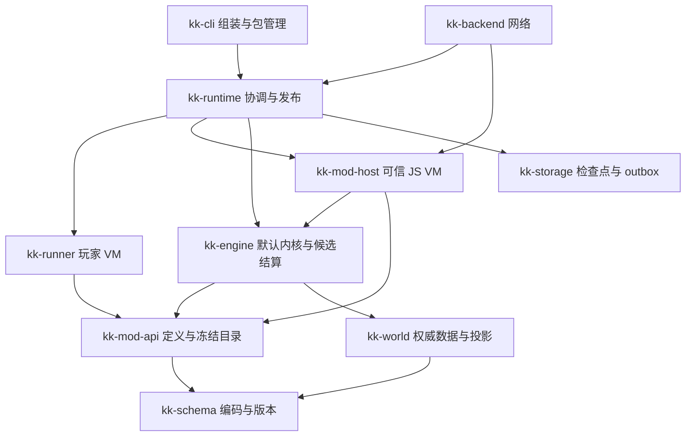

# 当前架构复审与 JS Mod 实现路线

**日期：2026-10-01；源码基准：`f89a5ea7ffe8b2aa6b93f6756588234cc810f2af`。性质：源码审计、可复现实验与待实施建议。用户已确认 Mod 作者编写 JS，不编写 Rust；不要求兼容官方 Mod 代码，但要求同类功能能力。具体 SDK 与改造方案尚未定案。**

结论是：**技术路线合理，模块分层有基础，值得继续演进；当前实现还不是成熟的高性能、全域事务、可深度扩展的服务器架构。无需推倒 Rust/V8/房间模型，但应在继续扩面和冻结存储格式之前补齐事务与扩展边界。** JS 可以实现深度玩法 Mod，Rust 负责默认实现和宿主服务；不能再将 JS 限定为管理、统计与轻量调整。

本篇与 [05 能力审查](05-mod-extensibility-review.md)配合阅读。05 的官方/xxscreeps 证据及现有封闭边界仍适用，其中外部 Rust Mod 的建议已被本次 JS-only 要求取代。详细 SDK、调用与存储设计见 [JS Mod 系统方案](../designs/mod-system.md)。

## 1. 哪些基础应保留

| 架构选择 | 评价与应保留的原因 | 当前边界 |
|---|---|---|
| Rust 权威结算 + V8 玩家执行 | 适合大量固定规则与现有 JS bot；无需为 Mod 把所有默认玩法翻译回 JS | 默认 Rust 处理器必须可被 JS 注册、包裹和替换 |
| schema → world → engine，runner 由 runtime 编排 | 领域与 VM、外部 I/O 可以分离；测试可避开 V8 | crate 名称不自动保证边界，`Engine` 仍混合部分协调职责，公开可变面较宽 |
| 房间为局部结算单位 | 空间索引、快照、加载/休眠、检查点都有自然粒度 | 玩家账户、市场、对象 ID 和世界 Mod 状态跨房，不能直接房间 `par_iter` |
| 单一 typed world + 派生投影 | 权威状态清楚，避免两套世界互相同步 | typed 内建对象外，需要正式扩展包络和附加字段；JSON 投影仍在热路径 |
| 不可变代际读取与候选结算 | 玩家对同一版本执行；失败房间不发布；现有重试缓存玩家结果 | 世界级版本指针、磁盘恢复、Mod 状态与 CPU 账本还未完全统一 |
| 空间索引、对象目录、地形缓存 | 已有真实收益，方向比微调循环语法有价值 | 未证明必须全面 ECS/SoA，不能把参考项目的微基准倍数当成本项目收益 |
| 兼容性棘轮和真实 bot 基线 | 适合作为渐进改造的行为护栏 | 不能替代 Mod 覆盖、崩溃一致性、100 玩家规模与资源隔离验收 |

`kk-storage`、`kk-backend` 和前端目前主要是占位；完整 serve/sim/test/import 子命令也仍是占位。因而“总体设计可以承载”和“当前服务已经具备”需要分别判断。架构文档中的共享字节、rayon、存储与网络目标不能计入已经落地的能力。

## 2. 当前最需要改造的边界

### 2.1 统一提交点应覆盖全部权威状态

源码锚点：[engine 结算](../../crates/kk-engine/src/settle/mod.rs) L723、[协调器](../../crates/kk-runtime/src/embed.rs) L500、L803、[线程 CPU 桶](../../crates/kk-runner/src/proto.rs) L258。

现在房间和部分玩家状态先产生候选，engine 内部发布房间、账户及 tick 后，runtime 再提交 RawMemory/segments，并给玩家线程发送 `settle_bill`。源码明确承认线程失联时忽略回执错误、漏计桶账，逐出重建会重置。这是已登记的现状，不应扩展成 Mod 的持久状态契约。

当前 `settle_market` 直接改 `self.market`；它后面没有返回结算错误的 Mod 回调，不能据此指控已有“市场异常回退”缺陷。**加入任何可失败的后续 Mod 阶段之前，必须让市场也进入候选。**

建议把权威状态统一为 `CommittedState`：rooms、players（含 Memory/segments/CPU 账本）、market、ID 分配状态、Mod 数据、规则/包指纹与 outbox。`prepare_tick` 产出拥有数据的 `TickTxn`，全部规则与校验完成后才 `publish`。沙箱只收到本轮预算，报告用量；扣桶由协调器候选计算，发布之后无需依赖工作线程确认。沙箱缓存丢失可以重建，账户账本不能随之丢失。

这不要求每 tick 深拷贝整个世界。先保证拥有权与发布纪律，再按修改房间、脏玩家、市场差异及 Mod 命名空间实现写时复制或增量候选。

### 2.2 基础设施失败需要真正的运行状态机

`execute_players` 遇到注入错误或 InfraFailure 会中止，局部结果不缓存。之前已经执行的 JS 堆仍可能变化；仅下一轮从已提交 Memory 注入，无法撤销玩家或 Mod 的全局变量。结算失败已有 PendingRound，基础设施失败则不能简单类比为同一种恢复。

建议状态机为 `Ready → Running → Prepared → Committed`，失败进入 `NeedsRecovery` 并禁止新的世界变异。已取得的结果是否保留必须显式定义：同一绑定版本下可以保留完成报告并只恢复失联玩家；若作废整轮，则先重置受影响沙箱，再按约定重新开始，不能在旧 JS 堆上悄悄重跑。结算重试继续复用完整玩家结果和原 TickInput。

线程命令应携带 tick、generation、request ID 与 worker epoch。为创建、注入、执行、关闭设置期限；迟到报告拒收；队列有限并有背压。当前大量 `.recv()` 没有期限，纯 JS 看门狗不能解决阻塞 native op 或挂住的线程。要强制恢复此类故障，需要按组的 worker 进程隔离与退出恢复；它是面向公网部署的下一层能力，不是 `recv_timeout` 本身能实现的。

### 2.3 玩家线程已经分开，生产编排仍逐个等待

源码锚点：[execute_players](../../crates/kk-runtime/src/embed.rs) L589、L673–L702；[run_player 通道](../../crates/kk-runner/src/proto.rs) L330。

当前每玩家注入并等回执，生成投影，再执行并等回执，然后才处理下一玩家。`tick_all` 虽然先发送后回收，但正式 embed 路径没有使用它，且它共享一份 world，不能直接替换 per-viewer 路径。

优先新增 `RunJob {view_handle, player_state, budget, code_revision, tick, generation}`，一次派发合并注入与执行，分开提交任务和收集结果。在有界并发下，各玩家读同一已提交版本；完成顺序任意，清洗、ID 分配和结算按既定序。并发上限需要实测 CPU、RSS 和 P99，而不是等于玩家数。

先保留一玩家一线程的已接受实现，消除串行等待；再评估线程数量。每玩家当前还有一个看门狗线程，约为 2N 条常驻线程。共享期限调度器是独立可测的优化，必须保留已有 arm/disarm/terminate 的代际原子性。固定 worker 上承载多个 V8 实例涉及线程亲和、进入/退出与销毁顺序，不是替换一个 channel 就能完成。

### 2.4 数据、规则与分派需要共同开放

只增加一个 JS tick callback 无法新增玩法。需要同时打通：新对象及已有对象附加字段、新资源、对象/房间/全局指令、有效规则表、内建行为替换、投影、玩家类、持久化和客户端贡献。

保留内建 Rust enum 与静态默认快速路径，增加稳定命名空间类型/动作 ID 和冻结注册表。新类型无需追加 Rust enum 变体；已有类型无需给每个 Mod 添加 Rust struct 字段。自定义建筑的所有权、视野、FIND/LOOK、障碍、容量、建造/维修/战斗能力由 descriptor 与 JS 规则共同定义。原生算法不能仍只看静态字符串白名单。

默认处理器按具名槽位开放 `before/after/wrap/replace`。数值覆盖与资源/建筑目录从同一 EffectiveRules 生成 Rust 判定和玩家常量。玩家 API 的错误码预检确实需要规则知识；“runner 不做任何规则判断”的旧文档措辞过于绝对。正确边界是：**runner 负责同版本的玩家调用语义，engine 独立执行权威验证；共享定义生成简单规则，复杂规则保留两侧对照测试。** 不能为消灭重复代码把每次玩家属性读和预检都变成宿主调用。

### 2.5 发布版本应成为网络、存储、Mod 的共同入口

现在 world 的只读 seam 已有基础，但 `Engine` 的 players/market/world 可变入口较宽，`commit_room` 依赖调用方维护代际；后续 HTTP、管理员命令和后台任务接入容易绕开发布点。

网络读取已提交 `WorldVersion`；管理员修改、定时任务、外部服务响应进入有身份与序号的命令队列，在 tick 边界成为记录输入。Mod 只修改候选事务，不能取得权威 Rust 裸可变引用。存储接受世界级检查点 manifest，不能独立选择各房最新记录拼世界。

manifest 应包含市场、玩家/CPU、ID、Mod 数据版本、Mod 内容/config 指纹、事件与必要重放输入。定期检查点仍有间隔内丢失进度的边界；可靠通知等通过持久 outbox 幂等重试。以上先定义恢复协议，再选择数据库，不能用数据库微基准代替崩溃一致性设计。

### 2.6 收敛两条玩家执行接口，明确库入口语义

[Engine](../../crates/kk-engine/src/settle/mod.rs) L630 仍持有 `sandboxes`；L681 的 `Engine::tick` 调假沙箱收指令后结算。它把所有非 Executed 结局（包括 InfraFailure）一并跳过，随后仍推进 tick；它也不消费 RunResult 的 Memory/CPU 候选。生产 embed 路径则由 runtime 编排，InfraFailure 会中止整轮，并执行玩家状态提交。

当前 engine Sandbox trait 的实现用于测试，**不是证实生产真沙箱正在错误吞故障**。但这两条公开入口语义不同，未来 sim/test/library 使用者可能选错；“测试与线上同一引擎”需要同一协调契约，而非仅同一个 settle_room 函数。建议 engine 只保留纯结算与 prepared transaction 接口，假执行器也走 runtime 的执行抽象；旧 `Engine::tick` 可保留明确限定的测试兼容 facade，不作为完整服务器执行入口。RunResult/RunSpec 等中性执行协议之后按依赖需要移动，避免再创造第三套接口。

### 2.7 文档要标出目标、现状和收益证据

snapshot-contract 已明确共享字节仍是目标，是好的范例。overall/storage/game-loop 中有些二进制指令、共享视图、Memory 增量及 runner 无规则判断的措辞仍像现成能力。建议统一加实现状态和源码锚点；性能文档把参考项目数字、孤立微基准、线性外推、端到端实测分开。分层图是边界约束，不能作为功能完成或收益达标证明。

## 3. 新鲜构建的性能证据

[复现脚本](../../scripts/benchmark/research/architecture-perf-probe-2026-10-01.py)与[完整结果](notes/architecture-perf-probe-2026-10-01.json)记录机器、rustc、commit、二进制 SHA256、12 次原始报告与工作负载自检。release 默认特性；每档 3 个独立进程，轮转 1/2/4/8 玩家；预热 500、采集 800 tick，终点 1300，避开初始 creep 1500 TTL 分段；串行执行各进程避免基准互相抢资源。

表为各运行 p50 的中位数，单位 ms/tick：

| 玩家 | 投影 | 玩家运行 | 结算 | 完整墙钟 |
|---:|---:|---:|---:|---:|
| 1 | 0.060 | 0.100 | 0.016 | 0.239 |
| 2 | 0.123 | 0.210 | 0.029 | 0.487 |
| 4 | 0.260 | 0.456 | 0.057 | 1.041 |
| 8 | 0.541 | 1.027 | 0.112 | 2.265 |

8 玩家 wall 的三次 p95 为 2.904/3.038/3.001 ms。该小负载中结算较小，投影与玩家执行更值得优先调查。完整墙钟还含注入、序列化、清洗、提交及其他编排开销；不能把“wall 减各相 p50”解释成某一个准确分项，也不能把 run 的墙钟视为纯 JS CPU。

**限制：**每玩家一个独立小房间；没有共享房、100 玩家、正式大房、官方或 xxscreeps 同功能对照；没有测进程 CPU、RSS、分配量、GC 或 Mod 开销。3×800 不满足正式 ≥5×3000 验收，故这只是当前瓶颈的探索证据，不能证明 5×/10×总体目标达标。旧 A6 空动作报告也不能作有效动作负载的收益基线。

### 3.1 性能优化应按此顺序验证

| 顺序 | 优化 | 需要测什么 | 不能提前下的结论 |
|---|---|---|---|
| 1 | 合并注入/执行命令，独立派发与回收，有界并发 | 1/8/100 玩家 wall、进程 CPU、P99、RSS、截止时间；同世界多玩家输出一致 | 线程存在不等于并行；并行降低墙钟不必然降低 CPU |
| 2 | 维护 user→可见房/私有对象目录，世界地图与市场版本通道 | 世界房间数增加时投影 CPU、字节数、视野增删/撤销正确性 | 当前拥有对象近似视野不等于全部官方 observer 等语义已实现 |
| 3 | 房间只读发布产物一次编码，多个查看者复用安全公共数据；私有 overlay 分离 | JSON 参考对照、编码/解析/分配成本、跨玩家共享房、旧引用/权限撤销 | `Arc<Value>` 后深 clone 不会自动减少成本；前置批该尝试曾回退 |
| 4 | 有收益后引入二进制视图、惰性 wrapper/字段物化、目录与变量 arena | 大 body/store、字符串、共享固定内存、峰值代际存活量、端到端 wall/CPU | 不要先同时改权威对象布局和玩家协议；冷门 getter 不必走共享字节 |
| 5 | Generic 过渡为经 schema 验证的扩展数据；缓存/减少反复 JSON 解析 | owner/投影/结构结算的 parse 次数、字符串分配、协议一致性 | 不能把所有对象改成动态 JSON 以求“灵活” |
| 6 | 脏房间与领域差异候选，空间桶压缩、body 派生缓存 | 修改密度、房间对象数、真实扫描/分配/复制比例 | 现有小房结算不足以证明全面 ECS/SoA 值得 |
| 7 | 房间并行与 run/process 重叠 | 同玩家跨房账户冲突、全局 ID、市场/跨房传输、世界级 Mod；与串行参考逐状态一致 | `Working` 借用共享 players/next_id，不能直接并行；世界 Mod 可能要求屏障 |

线程 CPU 计费与墙钟看门狗应分开：现有 Instant 是墙钟，调度争用会污染扣费。使用线程 CPU 时钟计量，墙钟用于活性保护，host/native 成本归属保持官方兼容口径；macOS/Linux 分别验证。此项影响正确性，宜在并发化验收中一起落地，不能只把 wall 优化后当作计费已经正确。

## 4. JS-only 的技术可行性已经进一步实测

新增独立实验：[Rust 宿主](../../spikes/deno-spike/examples/js_mod_host.rs)、[JS Mod 行为](../../spikes/deno-spike/examples/js_mod_host.js)、[采集脚本](../../scripts/benchmark/research/js-mod-host-probe-2026-10-01.py)、[完整结果](notes/js-mod-host-probe-2026-10-01.json)。版本 deno_core 0.412.0；已有 spike manifest 增加独立 `[workspace]`，让证据项目能独立运行，未改变生产 workspace 或引擎。

验证以下具体命题：

1. JS 注册并替换默认行为；JS `next()` 进入 Rust 默认步骤，默认步骤回调 JS 生命周期，生命周期继续调用 Rust ops 读写同一候选数据。
2. 外层及嵌套 JS 异常能传回宿主，候选写入存在但权威副本保持不变。
3. Rust 候选丢弃后 JS 全局 `volatileAttempts` 仍递增；销毁并重新装载运行时才清除。这证明 Mod 状态必须有显式事务来源。
4. 拒绝非有限数值与冻结后的注册；纯 JS 无限循环可经 V8 handle 截断，重建后可继续运行。
5. debug 与 release 均通过。debug 下启用 deno_core 嵌套 op 检查，回调 op 标记 `#[op2(reentrant)]`；OpState 和候选 RefCell 借用均在 JS 回调前释放。

这比“V8 能执行 JS”更接近关键实现障碍，但它**不是生产 Mod 系统**：数据是 f64 向量，不是真实 RoomState；没有实际游戏阶段、权限、迁移、存储、资源配额或 native 阻塞恢复。生产 native 处理器必须按相同借用纪律拆分，不能把带生命周期的 `Working<'w>` transmute 为 `'static` 后塞入 OpState。

### 4.1 批量传输不天然更快

实验让两种实现完成相同 N 个元素各 +1，检查最终值与 op 次数。field 为每元素一次读、一次写的同线程 fast op；batch 为 serde_v8 完整数组取出、JS 修改、完整写回。每模式 5 次预热与 5 次测量，每样本 100 遍，再取 5 个独立 release 进程的中位数：

| 每遍元素数 | field ops，µs/遍 | serde batch，µs/遍 | op 数：field / batch |
|---:|---:|---:|---:|
| 1 | 0.067 | 0.174 | 2 / 2 |
| 100 | 2.051 | 2.291 | 200 / 2 |
| 1000 | 11.508 | 20.548 | 2000 / 2 |

各进程样本与解释见结果文件；**它只比较这两种转换实现，不能代表 typed buffer、零复制视图、字符串、稀疏 patch 或 channel RPC，也不能代表真实 Mod 调用成本。**

结论是同线程轻量操作可作为可行起步路径，普通数组 batch 也有转换成本。对频繁读取使用快照/惰性视图，对密集数据用 typed columns + patch 的候选方案；对低频修改保留直接 ops。生产默认选择必须经实际对象、访问密度和 native 包裹链测量，不能仅根据“调用次数少”认定更快。玩家热点 getter 仍应留在玩家 VM 内，不能把本实验的可信 Mod ops 泛化到所有玩家属性。

## 5. 建议的模块演进

模块名称是建议。先在既有 crate 中定义边界也可以，依赖变复杂后再拆 crate；不以增加 crate 数为目标。`kk-mod-api` 仅数据描述与宿主无关契约，禁止依赖 V8；`kk-mod-host` 实现 JS 装载、回调和后台服务，不能让 engine 直接依赖 deno_core。Rust 默认实现是引擎内部优化，**不是给 Mod 作者提供第二套 Rust 插件系统**。

首版可采用一个可信玩法 VM 与 native 内核同线程串行执行，持有完整拥有权事务，另设后台 I/O 宿主。没有 Mod 时走当前纯 Rust 快速路径；有 Mod 时仅对有贡献的槽位进入 JS。先证明完整语义，再按房间隔离的读写范围复制宿主到多个 worker。不要首版同时做每 Mod 一个 VM、任意同步跨 VM `next()`、房间并行和热重载。

## 6. 改造批次与停止扩面的门槛

| 批次 | 具体改动 | 完成判据 |
|---|---|---|
| A 事务与故障边界 | Owned TickTxn、市场/CPU/Memory/Mod 状态同一发布点；状态机与 worker epoch | 世界/账户/桶/Mod 状态在任意可失败阶段一起回退；恢复后无迟到报告污染 |
| B 开放领域定义 | EffectiveRules、ObjectType/Extension、IntentDescriptor、handler graph、默认 slots | 新类型/动作不改核心枚举；已有字段可扩展；无 Mod 默认行为通过既有棘轮 |
| C JS 最小完整玩法 | Mod loader、可信 VM、玩家 API 安装、自定义 FIND/LOOK、counter 对象和动作；一个既有结构的 wrap/replace | **纯 JS 包**安装重启即可；玩家→意图→结算→投影闭环；异常/超时整轮回退 |
| D 性能与真实规则 | 合并 RunJob、并发回收、线程 CPU；公开移动/战斗/建造/容量等必要 slots | 同房/跨房串行参考一致；典型 counter、新资源建筑和规则替换 Mod 实测 overhead |
| E 首次持久化前 | extension 编码、manifest、迁移/缺失 Mod、输入日志与 outbox | 各写盘步骤崩溃注入只恢复完整版本；卸载/升级不静默丢数据 |
| F 网络/客户端随 M3 | JS routes/auth/subscription/providers、资产/renderer/panel/types、握手 | 官方自定义对象示例同类能力完整复现；自建客户端与官方客户端需求分别验收 |
| G 完整能力收口 | 世界生成、周期任务、存储 provider、NPC/经济/跨房规则 | [Mod 方案验收矩阵](../designs/mod-system.md#12-能力验收矩阵)全覆盖；真实大规模基准达标 |

建议 A/B/C 前移，不能把 Mod 的核心边界整体留在 M4。这不是要求停掉所有 vanilla 开发：不受这些边界影响的兼容性补全可以继续；新存储格式、新的封闭动作/对象分派、可失败全局处理应先用新契约。

未给日历工期：生产内核借用重构、生命周期 slots 颗粒度与 snapshot 优化需要实际切片验证，现有证据不足以可靠报“几天完成”。每批都应保留可独立评审的产物和串行参考。

## 7. 结论的实际限度

官方 Mod 可修改其 Node 内部任意方法，有限公共 API 无法数学上保证复现所有内部补丁。这里承诺的目标应是完整业务领域及其替换能力：玩法、对象、指令、沙箱、地图、存储、网络、管理和图形。发现新业务域缺口，就补 JS 宿主契约；**不能以“作者写 Rust”作为补救方式。** 官方文档本身包括自定义游戏规则、对象与图形：[Community Servers](https://docs.screeps.com/community-servers.html)。

本次给出的方案能解释这些能力如何进入当前架构，实验关闭了嵌套调用的一个主要风险，尚未证明生产系统已具备全部能力或达到正式性能目标。最重要的下一步是 A/B/C 的纵向样本，而不是继续堆更多静态 enum/match 后再加加载器。
