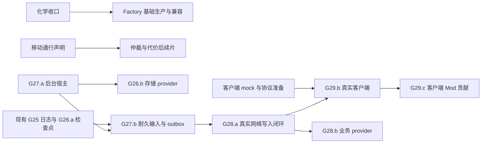

# 开发缺口与并行工作建议

本页是 **2026-10-08 的历史调研记录**，基于 HEAD `6be27b0` 与当时未提交工作区进行静态核查，未重新构建或运行游戏测试。当前状态仍以[接手台账](../plans/mod-next-batches.md)为准；以下分工是建议，未实际启动开发。

## 核查结论与证据

项目已有内存引擎、玩家沙箱、真实寻路、核心经济/战斗/跨房移动/市场结算、JS Mod 基础、本地模拟、检查点与结算回放。距离完整服务器主要差在默认玩法覆盖、生产存储、异步宿主、联网服务、应用客户端和最终验收。

必须分开理解默认玩法、Mod 替换能力和真实产品验收。例如塔已有默认动作，G14 未开始表示 Mod 塔策略入口未开放；terminal/市场已有结算，G17/G18 未开始不表示整个终端与市场尚未开发。

- [CLI 分派](../../crates/kk-cli/src/main.rs)：serve/test/import 返回退出码 2；[Mod 命令](../../crates/kk-cli/src/mod_tools/command.rs)已实现 init/test/inspect/types。顶层 test 未完成与 mod test 已完成并不矛盾。
- [backend](../../crates/kk-backend/src/lib.rs)、[storage](../../crates/kk-storage/src/lib.rs)是预留模块；runtime 已有本地文件检查点，不能解释为完全不能保存。
- [前端架构](../architecture/frontend.md)与实际文件：shared/renderer 已实现；game/api/editor 仍占位。总体架构中把 packages 全称为占位的表述已过时。
- 已提交兼容报告：2914 总用例，1983 passed、24 failed、907 skipped，约 68.1%。当时工作区[报告](../../compat/reports/kkscreeps.json)：2274 passed、24 failed、616 skipped，约 78.0%，报告及地板尚未提交。
- 工作区含实验室 run/reverse/boost/unboost 的意图、结算、玩家预检、快照及测试，chemistry 开关已开启。这是**在途实现与已有报告**，本次未独立验证其正确性、完整门禁或交付状态，不应另派人重复开发。

全套件 95% 至少需要 2769 通过；相对当时工作区仍差 495。即使 24 失败全部修复，也只有 2298/2914，约 78.9%。大量跳过项是后续覆盖提升的主要来源，不通过扩大跳过范围或缩小分母满足目标。

## 剩余工作

| 领域 | 剩余范围 |
|---|---|
| 默认玩法 | factory/commodity、power creep/account/effects/powerSpawn、observer、nuke、deposit、powerBank、keeper/NPC/invader/stronghold、portal、跨 shard/InterShardMemory 等业务闭环；化学实现待收口 |
| 零散兼容差异 | 24 failed 涉及 setup/inspection、拉拽疲劳、路径参数与缓存、NPC/keeper、VM 模块引用/缓存、对象形状、事件；部分可能为官方同红或已登记差异，需逐项取证 |
| 完整世界 | 世界初始化/导入、地形生成、自主 NPC/世界事件、真实外部 bot 在持续推进世界中的完整玩法验收 |
| Mod 移动 | 结构/rampart 寻路通行声明、逐房规则、完整仲裁替换、障碍槽预演、疲劳恢复与重量评分（G02–G04） |
| Mod 对象/生产 | 多配方/具名生产动作与进度、特殊/逐资源容量、动态/逐房配额、Mod 建筑查询及生产事件、自有对象后续能力（G08–G11） |
| Mod 其他规则与全局域 | 采集再生、孵化/寿命/死亡、塔、成长、实验室/工厂、跨房资源/市场策略；房间/玩家/世界生命周期及世界事件（G12–G21） |
| 更新与作者工具 | 内容级 schema/state 迁移、watch、trace 过滤/一键复现、独立跨进程 replay、跨包切换历史回放、顶层 test/import/deploy 工作流 |
| 生产存储与后台 | 数据库/provider、服务器周期调度、异步后台宿主、世界/输入/outbox 原子耐久发布、确认后输出及去重（G26–G27） |
| 网络 | 真实监听、认证/授权、代码上传、订阅/重连/背压、控制台、业务 provider、官方客户端协议验证（G28） |
| 客户端 | Vue 应用、网络 api、编辑器、登录/观战/对象详情/Memory/控制台、地图/市场/历史界面、客户端 Mod 贡献、DTO/常量生成与发布（G29） |
| 最终验收 | 全域覆盖清单、完整官方预设、同功能对照、renderer R7 最终矩阵/长测、72h 长跑与部署隔离（G30、M5） |

默认玩法名单来自能力开关、结算代码与报告跳过家族，部分已有类型/getter/容量等局部支持，不能将它们描述为完全没有代码。renderer 长测此前被用户暂缓，本次不启动。

## 推荐第一轮四条并行线

按**完整业务切片**分工，每条线负责声明/玩家预检、意图清洗、结算、投影、保存恢复与验证。按 Rust/JS/测试技术层派人，会增加等待和漏接消费者的风险。

| 工作流 | 首个可验收切片 | 主要区域 | 并行条件 |
|---|---|---|---|
| A 默认玩法覆盖 | 在途化学收口；随后 factory 基础生产，power effects 另拆依赖片 | engine 对应领域、runner 结构 API、world 投影、compat | 先确认库存/boost 契约；不多人改同一中心分派 |
| B 移动与 Mod 规则 | G02.d3 结构/rampart 通行声明，使 moveTo/PathFinder 与结算同源 | movement、pathfinding、mod-api、独立夹具 | 与 A 分离；共享 builtin revision/注册由集成人收口 |
| C 后台与存储 | G27.a 最小异步宿主：生命周期、探针 I/O、已提交只读面 | mod-host 后台域、runtime、独立测试 | 首片不改玩法，不依赖 JS storage/outbox；随后接 provider 与耐久事务 |
| D 客户端准备 | 网络映射契约草案，mock 数据接 renderer 的观战界面 | shared、api、apps/game | 前后端共定版本/权限/重同步；mock 不算真实联网交付 |

人数不足时优先 A/B/C；更多人可独立做 observer 默认动作、兼容失败取证、trace/CLI 改善或公共 SDK 官方内容包。observer 影响玩家视野，仍需当片补恢复和授权验证。keeper/NPC、power 大域先拆状态基础；不要无契约地同时推进多个库存/boost/effects 消费者。

## 后续依赖

G27.b 需要定义世界、已消费输入、待输出记录的原子耐久版本和确认点。现有日志在**内存提交后**追加，失败时世界已提交；直接沿用该时序不能承诺网络命令确认后的耐久性。outbox 可用 native 后端先行，不必等待 JS provider，所以 provider 和 outbox 后续接线可并行。网络只读协议/监听原型可提前，改变世界的真实请求仍等待持久提交边界。

另一条依赖是内容级迁移 → watch；现有包集合切换拒绝同包内容变化，文件监视不能替代存量升级。

## 并行集成约定

1. 每条线独立 worktree 分支；当前未提交化学实现由其负责者验收提交，其他分支再选择该提交作为基线，不自动搬走或暂存他人的工作。
2. 共享接口先以小提交确定字段、错误语义、状态所有权、版本/PlanHash 和验收。接口草案不能当功能完成。
3. 一个集成负责者收口 IntentData/调度注册、builtin revision/catalog、检查点清单、CLI 注册、compat capabilities/报告和台账；实现放领域模块，共享注册尽量最后接入。
4. 库存/boost/effects、玩家/世界生命周期、跨房市场等共享写域需先确定契约；按文件夹分开不能消除行为冲突。
5. 开发中跑相关子集，合入前跑无参数完整门禁。兼容改动重建 release、跑棘轮和适用 bot；最终报告由集成产物生成，不合并各分支 JSON 冒充整合验证。独立构建目录避免覆盖 CLI 产物，冷恢复绑定该分支实际可执行文件。
6. 新状态当片补版本、保存/冷恢复、失败重试；Mod 策略按要求提供独立 JS 包、原生对照、组合和双投影。各自测试通过不能替代最终集成验证。
7. 台账及时合并各线已完成、在途、剩余消费者、依赖和实际检查，不按 G 父编号串行，不把首片完成写成全领域完成。

近期建议：先明确化学在途状态并确认公共库存/boost 边界，并行启动移动通行、后台宿主与客户端协议/mock。默认玩法线补 factory 等大跳过家族，同时分类 24 失败；后台线尽早打通存储到网络的关键路径。G30.a 覆盖清单与 G30.d 同功能参考随交付滚动建立，本次静态核查不标为 G30 完成。
